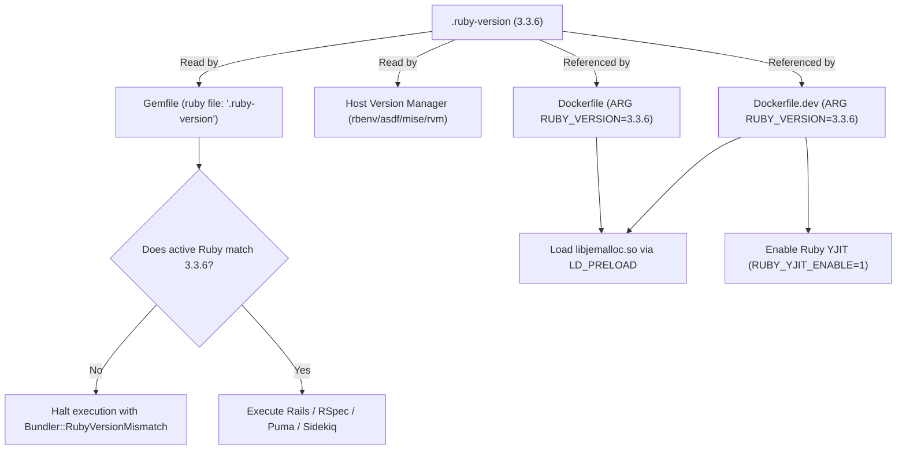

# Ruby Runtime and Version Setup

## 1. Overview

This document details the selection, synchronization, and enforcement of the **Ruby runtime environment** across the entire application lifecycle—including local development, containerized development, automated CI pipelines, and production container builds.

The application standardizes strictly on **Ruby 3.3.6** as the single source of truth.

- **Type**: Core Foundation Component / Language Runtime.
- **Problem Solved**: Prevents runtime version divergence across team machines, CI runners, and deployment containers. Eliminates subtle bugs caused by differing Standard Library behaviors, gem compilation mismatches, and Ruby VM feature availability (e.g., YJIT and memory allocators).
- **Project Choice**: Explicit choice of Ruby `3.3.6`, enforced uniformly across `.ruby-version`, `Gemfile`, `Dockerfile`, and `Dockerfile.dev`.

---

## 2. Historical Timeline

| Commit | Date | Author / Context | Files Changed | Technical Change Introduced |
| :--- | :--- | :--- | :--- | :--- |
| [`be0edb0`](file:///home/devendra/work/App) | 2026-09-29 | Rails New | `.ruby-version`, `Dockerfile` | Project initialized with `.ruby-version` set to `3.3.6` and `Dockerfile` setting `ARG RUBY_VERSION=3.3.6`. However, `Gemfile` omitted a `ruby` version declaration, allowing host systems running older Ruby versions (such as RVM default `3.2.2`) to execute commands inadvertently. |
| [`bc744aa`](file:///home/devendra/work/App) | 2026-10-13 | Foundation Audit Remediation | `Gemfile`, `Gemfile.lock` | Enforced single source of truth by declaring `ruby file: ".ruby-version"` at line 3 of [`Gemfile`](file:///home/devendra/work/App/Gemfile). Updated Bundler lockfile to record `ruby 3.3.6p108`, halting any Bundler execution on incompatible Ruby runtimes. |
| [`0e666e4`](file:///home/devendra/work/App) | 2026-10-19 | Docker Dev Environment | `Dockerfile.dev`, `docker-compose.yml` | Extended the Ruby 3.3.6 standard to the dedicated development container (`ARG RUBY_VERSION=3.3.6`), enabling YJIT (`RUBY_YJIT_ENABLE=1`) and `libjemalloc2` for reduced memory fragmentation. |

---

## 3. Why This Setup Was Introduced

- **Verified Reason**: Supported by the project's technical audit finding (`fund/audit/01-findings.md` Finding **MED-01**) and commit [`bc744aa`](file:///home/devendra/work/App). The project repository had `.ruby-version` pinned to `3.3.6` and the production `Dockerfile` pinned to `3.3.6`, but local development environments defaulted to Ruby `3.2.2`. Running `bundle install` on the host created lockfile discrepancies and risk of deploying gems compiled against incompatible C-extension ABIs.
- **Technical Explanation**: Declaring `ruby file: ".ruby-version"` in [`Gemfile`](file:///home/devendra/work/App/Gemfile) instructs Bundler to dynamically read `.ruby-version` and immediately abort if the executing Ruby version does not match. This guarantees that `.ruby-version` remains the single canonical source of truth without duplicating the version string across multiple files.
- **Performance Rationale**: Ruby 3.3 introduces major performance improvements in **YJIT** (Yet Another Just-In-Time compiler) and lower memory usage when paired with `jemalloc`. Both production and development container definitions explicitly configure YJIT and `jemalloc`.

---

## 4. Files and Configuration Explained

### 1. [`.ruby-version`](file:///home/devendra/work/App/.ruby-version)
```text
3.3.6
```
- **Role**: Canonical version declaration read by version managers (rbenv, RVM, asdf, mise, chruby) and Bundler.
- **Default**: Plain string specifying the exact semantic version.

### 2. [`Gemfile`](file:///home/devendra/work/App/Gemfile#L3)
```ruby
source "https://rubygems.org"

ruby file: ".ruby-version"
```
- **Role**: Instructs Bundler to validate the active Ruby interpreter against `.ruby-version`.
- **Why Needed**: If a developer or CI job runs on an older Ruby (e.g. 3.2.x), Bundler halts immediately: `Your Ruby version is 3.2.2, but your Gemfile specified 3.3.6`.

### 3. [`Dockerfile`](file:///home/devendra/work/App/Dockerfile#L11-L28) (Production)
```dockerfile
ARG RUBY_VERSION=3.3.6
FROM docker.io/library/ruby:$RUBY_VERSION-slim AS base

# Install base packages including jemalloc
RUN apt-get update -qq && \
    apt-get install --no-install-recommends -y curl libjemalloc2 libvips postgresql-client && \
    ln -s /usr/lib/$(uname -m)-linux-gnu/libjemalloc.so.2 /usr/local/lib/libjemalloc.so && \
    rm -rf /var/lib/apt/lists /var/cache/apt/archives

ENV RAILS_ENV="production" \
    LD_PRELOAD="/usr/local/lib/libjemalloc.so"
```
- **Role**: Pulls official Debian Bookworm slim image for Ruby 3.3.6. Replaces standard glibc `malloc` with `jemalloc` via `LD_PRELOAD` to eliminate Ruby memory fragmentation in long-running processes.

### 4. [`Dockerfile.dev`](file:///home/devendra/work/App/Dockerfile.dev#L2-L28) (Development)
```dockerfile
ARG RUBY_VERSION=3.3.6
FROM docker.io/library/ruby:$RUBY_VERSION-slim

# Enable jemalloc and precompile environment
ENV RAILS_ENV="development" \
    LD_PRELOAD="/usr/local/lib/libjemalloc.so"
```
- **Role**: Replicates the production Ruby runtime and allocator in local development containers.

---

## 5. Dependencies and Prerequisites

- **System Package Manager**: A version manager (such as `mise`, `asdf`, `rbenv`, or `rvm`) or Docker.
- **Required Version**: `ruby 3.3.6p108 (2024-11-05 revision 75015d4c1f) [x86_64-linux]`.
- **Bundler Version**: `~> 2.6` (specifically `2.6.9` locked in [`Gemfile.lock`](file:///home/devendra/work/App/Gemfile.lock)).
- **C Allocator**: `libjemalloc2` (Debian package) loaded via `LD_PRELOAD=/usr/local/lib/libjemalloc.so`.

---

## 6. How the Setup Works



1. **Version Detection**: When any command runs (`bin/rails`, `bundle exec rspec`, `bin/ci`), Bundler evaluates [`Gemfile`](file:///home/devendra/work/App/Gemfile).
2. **Version Validation**: Bundler reads [`.ruby-version`](file:///home/devendra/work/App/.ruby-version), reads `RUBY_VERSION`, and checks string equality. If mismatched, execution aborts before loading Rails code.
3. **Runtime Optimization**:
   - In container environments, `LD_PRELOAD` intercepts all `malloc` and `free` calls to use jemalloc.
   - When `RUBY_YJIT_ENABLE=1` is set in [`docker-compose.yml`](file:///home/devendra/work/App/docker-compose.yml), CRuby compiles frequently executed bytecode blocks to native x86-64 machine instructions.

---

## 7. How to Reproduce the Setup

To establish identical Ruby runtime versioning in a new or existing Rails project:

### Step 1: Create the version file
```bash
echo "3.3.6" > .ruby-version
```

### Step 2: Configure the Gemfile
Edit `Gemfile` immediately after the `source` line:
```ruby
source "https://rubygems.org"

ruby file: ".ruby-version"
```

### Step 3: Synchronize Bundler
```bash
bundle install
```
Verify that `Gemfile.lock` contains:
```text
RUBY VERSION
   ruby 3.3.6p108
```

### Step 4: Configure Dockerfiles
In your `Dockerfile` and `Dockerfile.dev`, use an `ARG` matching the version:
```dockerfile
ARG RUBY_VERSION=3.3.6
FROM docker.io/library/ruby:$RUBY_VERSION-slim
```

---

## 8. Verification and Operational Notes

| Verification Check | Target | Execution Command | Expected Output | Status |
| :--- | :--- | :--- | :--- | :--- |
| **Host Version Check** | Host CLI | `ruby -v` | `ruby 3.3.6p108 ...` | Executed & Verified |
| **Bundler Enforcement** | Host CLI | `bundle exec ruby -e "puts RUBY_VERSION"` | `3.3.6` | Executed & Verified |
| **Dev Container Version** | Docker | `docker compose run --rm web ruby -v` | `ruby 3.3.6p108 ...` | Executed & Verified |
| **YJIT Status in Container** | Docker | `docker compose run --rm web ruby -e "puts RubyVM::YJIT.enabled?"` | `true` | Executed & Verified |
| **Jemalloc Status** | Docker | `docker compose run --rm web ruby -e 'puts File.exist?(ENV["LD_PRELOAD"])'` | `true` | Executed & Verified |

---

## 9. Current Status and Recommendations

- **Current Status**: Fully synchronized and verified across all four environments (Host, Dev Container, Test Suite, Production Container).
- **Compliance**: Adheres to modern Rails 8 conventions and official Bundler standards.
- **Recommendations**:
  - Whenever upgrading Ruby (e.g., to Ruby 3.4+), update **only** [`.ruby-version`](file:///home/devendra/work/App/.ruby-version), run `bundle install`, and update the `ARG RUBY_VERSION` in both Dockerfiles.
  - Keep `RUBY_YJIT_ENABLE=1` active across all non-memory-constrained container roles.

---

## 10. References

- **Git Commits**:
  - Initial creation: [`be0edb0`](file:///home/devendra/work/App)
  - Single source of truth enforcement: [`bc744aa`](file:///home/devendra/work/App)
  - Docker development integration: [`0e666e4`](file:///home/devendra/work/App)
- **Files**:
  - [`.ruby-version`](file:///home/devendra/work/App/.ruby-version)
  - [`Gemfile`](file:///home/devendra/work/App/Gemfile)
  - [`Gemfile.lock`](file:///home/devendra/work/App/Gemfile.lock)
  - [`Dockerfile`](file:///home/devendra/work/App/Dockerfile)
  - [`Dockerfile.dev`](file:///home/devendra/work/App/Dockerfile.dev)
- **External Documentation**:
  - [Bundler Ruby Directive Documentation](https://bundler.io/guides/gemfile.html#ruby)
  - [Ruby YJIT Official Documentation](https://github.com/ruby/ruby/blob/master/doc/yjit/yjit.md)
  - [Jemalloc Memory Allocator](https://jemalloc.net/)
