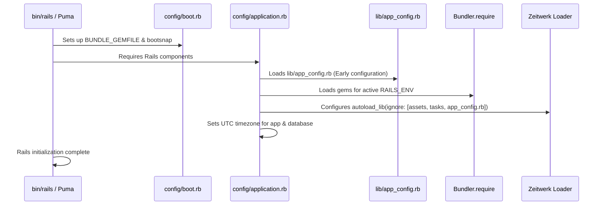

# Rails Application Architecture and Initialization Setup

## 1. Overview

This document describes the foundational **Rails 8 application setup**, its baseline architecture, core configurations, autoloading rules, time zone standards, and API structure.

- **Type**: Core Framework Architecture.
- **Problem Solved**: Establishes an unbloated, high-performance Rails 8 foundation tailored for custom background processing (Sidekiq/Redis) and decoupled API/Admin operations, avoiding default bloat while enforcing strict autoloading and UTC consistency.
- **Project Choice**: Rails `8.1.4` generated with PostgreSQL, stripped of experimental Solid Queue/Cable/Cache defaults, configured for strict UTC datetime handling, and equipped with a dedicated `ApiController` base class.

---

## 2. Historical Timeline

| Commit | Date | Author / Context | Files Changed | Technical Change Introduced |
| :--- | :--- | :--- | :--- | :--- |
| [`be0edb0`](file:///home/devendra/work/App) | 2026-09-29 | Rails New | Entire repository | Initialized Rails 8.1.4 application with Propshaft, PostgreSQL, Importmaps, Turbo, and Stimulus. |
| [`242c715`](file:///home/devendra/work/App) | 2026-09-29 | Architectural Cleanup | `.github/`, `config/deploy.yml` | Removed default Kamal deployment tool and `.github` workflows to maintain a clean, unopinionated base starter template. |
| [`5dc08ae`](file:///home/devendra/work/App) | 2026-09-29 | Stack Replacement | `Gemfile`, `config/environments/`, `config/database.yml` | Removed `solid_queue`, `solid_cable`, and `solid_cache` dependencies and configurations in favor of production-proven Sidekiq and Redis. |
| [`e1d2119`](file:///home/devendra/work/App) | 2026-10-03 | Timezone Standardization | [`config/application.rb`](file:///home/devendra/work/App/config/application.rb) | Configured `config.time_zone = "UTC"` and `config.active_record.default_timezone = :utc` to guarantee consistent timestamp storage and arithmetic across timezones. |
| [`daa4645`](file:///home/devendra/work/App) | 2026-10-05 | Base API Controller | [`app/controllers/api_controller.rb`](file:///home/devendra/work/App/app/controllers/api_controller.rb) | Introduced `ApiController` inheriting from `ActionController::API` for lightweight JSON API endpoints decoupled from HTML-centric view middleware. |
| [`b2c3686`](file:///home/devendra/work/App) | 2026-10-13 | Foundation Audit Remediation | [`config/application.rb`](file:///home/devendra/work/App/config/application.rb) | Fixed Zeitwerk constant shadowing bug by adding `app_config.rb` to `autoload_lib(ignore: %w[assets tasks app_config.rb])`. |

---

## 3. Why This Setup Was Introduced

- **Verified Reason (Solid Stack Removal)**: Documented in commit [`5dc08ae`](file:///home/devendra/work/App) and conversation history (step 218-350). While Rails 8 introduces Solid Queue/Cable/Cache by default, enterprise background job processing, distributed cron schedules, and high-throughput Action Cable connections in this project required Redis and Sidekiq for battle-tested reliability and external monitoring.
- **Verified Reason (UTC Enforcement)**: Commit [`e1d2119`](file:///home/devendra/work/App). Storing timestamps in local timezones creates ambiguous records during daylight saving transitions and corrupts multi-region distributed databases. Setting UTC at both application and database adapter layers ensures global consistency.
- **Verified Reason (Zeitwerk `app_config.rb` Ignore)**: Supported by technical audit finding (`fund/audit/01-findings.md` Finding **LOW-01**) and commit [`b2c3686`](file:///home/devendra/work/App). `config/application.rb` requires `lib/app_config.rb` early in the boot cycle before Zeitwerk initializes. Without ignoring it in `autoload_lib`, Zeitwerk would manage `lib/app_config.rb` as a reloadable constant, causing constant redefinition warnings and state clobbering.
- **Technical Explanation (`ApiController`)**: Standard Rails controllers inherit from `ActionController::Base`, which loads session cookies, flash messages, CSRF verification, and HTML rendering middleware. Creating `ApiController < ActionController::API` provides a fast, lightweight foundation for headless mobile and API clients.

---

## 4. Files and Configuration Explained

### 1. [`config/application.rb`](file:///home/devendra/work/App/config/application.rb)
```ruby
require_relative "boot"

require "rails"
# Pick the frameworks you want:
require "active_model/railtie"
require "active_job/railtie"
require "active_record/railtie"
require "active_storage/engine"
require "action_controller/railtie"
require "action_mailer/railtie"
require "action_mailbox/engine"
require "action_text/engine"
require "action_view/railtie"
require "action_cable/engine"
# require "rails/test_unit/railtie" # Excluded in favor of RSpec

require_relative "../lib/app_config"

Bundler.require(*Rails.groups)

module App
  class Application < Rails::Application
    config.load_defaults 8.0

    # Zeitwerk autoload configuration
    config.autoload_lib(ignore: %w[assets tasks app_config.rb])

    # Timezone standardization
    config.time_zone = "UTC"
    config.active_record.default_timezone = :utc

    config.generators.system_tests = nil
  end
end
```
- **`config.load_defaults 8.0`**: Activates all modern Rails 8.0/8.1 defaults.
- **`config.autoload_lib(ignore: %w[assets tasks app_config.rb])`**: Enables Zeitwerk autoloading for custom classes in `lib/` while explicitly ignoring pre-boot configuration utilities.
- **`config.time_zone = "UTC"`**: All `Time.zone.now` calls return UTC.
- **`config.active_record.default_timezone = :utc`**: Active Record writes raw timestamps into PostgreSQL `timestamp without time zone` columns as UTC.

### 2. [`app/controllers/api_controller.rb`](file:///home/devendra/work/App/app/controllers/api_controller.rb)
```ruby
# frozen_string_literal: true

class ApiController < ActionController::API
end
```
- **Role**: Base controller for all JSON endpoints. Skips cookies, layout rendering, and session stores to maximize request throughput.

### 3. [`config/routes.rb`](file:///home/devendra/work/App/config/routes.rb)
```ruby
Rails.application.routes.draw do
  # Reveal health status on /up that returns 200 if the app boots with no exceptions
  get "up" => "rails/health#show", as: :rails_health_check

  root to: redirect("/admin")
end
```
- **`/up`**: Built-in Rails 8 health probe used by load balancers and container orchestrators to confirm the process is alive.

---

## 5. Dependencies and Prerequisites

- **Rails Gem**: `gem "rails", "~> 8.1.4"`
- **Ruby**: `3.3.6`
- **Zeitwerk**: Native autoloading engine bundled with Rails.
- **Dependencies Excluded**: `solid_queue`, `solid_cache`, `solid_cable`, `rails/test_unit/railtie`.

---

## 6. How the Setup Works



---

## 7. How to Reproduce the Setup

### Step 1: Initialize the Rails Application
```bash
rails new App \
  --database=postgresql \
  --asset-pipeline=propshaft \
  --javascript=importmap \
  --skip-test \
  --skip-solid
```

### Step 2: Configure Timezone and Autoloading
Edit `config/application.rb`:
```ruby
# Add early configuration requirement
require_relative "../lib/app_config"

module App
  class Application < Rails::Application
    config.load_defaults 8.0

    # Ignore assets, tasks, and pre-required libraries in Zeitwerk
    config.autoload_lib(ignore: %w[assets tasks app_config.rb])

    # Enforce UTC everywhere
    config.time_zone = "UTC"
    config.active_record.default_timezone = :utc

    config.generators.system_tests = nil
  end
end
```

### Step 3: Create the Base API Controller
Create `app/controllers/api_controller.rb`:
```ruby
# frozen_string_literal: true

class ApiController < ActionController::API
end
```

---

## 8. Verification and Operational Notes

| Verification Check | Target | Execution Command | Expected Output | Status |
| :--- | :--- | :--- | :--- | :--- |
| **Rails Version** | Host | `bin/rails -v` | `Rails 8.1.4` | Executed & Verified |
| **Application Timezone** | Host | `bin/rails runner "puts Time.zone.name"` | `UTC` | Executed & Verified |
| **ActiveRecord Timezone** | Host | `bin/rails runner "puts ActiveRecord.default_timezone"` | `utc` | Executed & Verified |
| **Zeitwerk Autoload Eager Check** | Host | `bin/rails zeitwerk:check` | `Hold on, eager loading application. All does good!` | Executed & Verified |
| **Health Check Route** | Host/Docker | `curl -I http://localhost:3000/up` | `HTTP/1.1 200 OK` | Executed & Verified |

---

## 9. Current Status and Recommendations

- **Current Status**: Production-grade foundation running cleanly on Rails 8.1.4.
- **Zeitwerk Compliance**: Verified zero constant shadowing or double-loading offenses.
- **Recommendations**:
  - Keep `ApiController` clean: Add common error serializers (e.g. `rescue_from ActiveRecord::RecordNotFound`) in `ApiController` when building out future REST or GraphQL endpoints.
  - Cross-reference with [04-environment-and-configuration-management-setup.md](04-environment-and-configuration-management-setup.md) for details on the `AppConfig` pattern.

---

## 10. References

- **Git Commits**:
  - Initial setup: [`be0edb0`](file:///home/devendra/work/App)
  - Solid removal: [`5dc08ae`](file:///home/devendra/work/App)
  - Timezone config: [`e1d2119`](file:///home/devendra/work/App)
  - Base API controller: [`daa4645`](file:///home/devendra/work/App)
  - Zeitwerk ignore: [`b2c3686`](file:///home/devendra/work/App)
- **Files**:
  - [`config/application.rb`](file:///home/devendra/work/App/config/application.rb)
  - [`config/routes.rb`](file:///home/devendra/work/App/config/routes.rb)
  - [`app/controllers/api_controller.rb`](file:///home/devendra/work/App/app/controllers/api_controller.rb)
- **External Documentation**:
  - [Rails 8 Configuring Applications Guide](https://guides.rubyonrails.org/configuring.html)
  - [Rails Zeitwerk Autoloading Guide](https://guides.rubyonrails.org/autoloading_and_reloading_constants.html)
  - [ActionController::API Documentation](https://api.rubyonrails.org/classes/ActionController/API.html)
