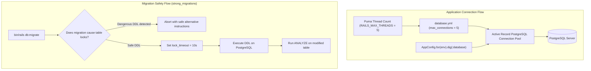

# Database and Migrations Setup

## 1. Overview

This document explains the **database architecture, connection pooling, migration safety framework, and deployment decoupling** implemented in this application.

- **Database Engine**: PostgreSQL 15+ (PostgreSQL 16 in Docker).
- **Ruby Adapter**: `pg` gem (~> 1.1).
- **Problems Solved**:
  - Eliminates connection exhaustion by sizing connection pools dynamically with thread counts (`max_connections`).
  - Protects production against table-locking migrations via [`strong_migrations`](https://github.com/ankane/strong_migrations).
  - Eliminates concurrent migration race conditions during multi-container deployments.
  - Keeps connection credentials centralized and decoupled via [`AppConfig`](file:///home/devendra/work/App/lib/app_config.rb).

---

## 2. Historical Timeline

| Commit | Date | Author / Context | Files Changed | Technical Change Introduced |
| :--- | :--- | :--- | :--- | :--- |
| [`be0edb0`](file:///home/devendra/work/App) | 2026-09-29 | Rails New | `config/database.yml`, `Gemfile` | Initialized PostgreSQL database configuration with standard Rails boilerplate. |
| [`226fcb0`](file:///home/devendra/work/App) | 2026-10-02 | AppConfig Introduction | `config/database.yml` | Refactored `database.yml` to retrieve host, port, username, password, and database name from `AppConfig.for(env).dig(:database)`. |
| [`53a9c81`](file:///home/devendra/work/App) | 2026-10-05 | Migration Setup | `db/migrate/` | Initialized Active Record migration tracking schema. |
| [`aabf285`](file:///home/devendra/work/App) | 2026-10-05 | Pool Sizing | `config/database.yml` | Adopted Rails 8's new `max_connections` directive with dynamic fallback: `ENV["DB_POOL"].presence || ENV.fetch("RAILS_MAX_THREADS", 5)`. |
| [`7890f45`](file:///home/devendra/work/App) | 2026-10-11 | Zero-Downtime Migrations | `Gemfile`, `config/initializers/strong_migrations.rb` | Added `strong_migrations` gem. Configured lock timeout (`10.seconds`), statement timeout (`1.hour`), and automated table analysis after adding indexes. |
| [`ee22b53`](file:///home/devendra/work/App) | 2026-10-13 | Audit Remediation | `bin/docker-entrypoint` | Removed `db:prepare` from the web container entrypoint. Decoupled migrations from container boot to eliminate race conditions when launching multiple web replicas. |
| [`fc5498e`](file:///home/devendra/work/App) | 2026-10-19 | Container Support | `config/settings/settings-{development,test}.yml` | Added dynamic `DATABASE_NAME` environment override support (`ENV["DATABASE_NAME"].presence || "app_development"`). |
| [`0e666e4`](file:///home/devendra/work/App) | 2026-10-19 | Docker Dev Stack | `.docker/postgres/init-test-db.sh`, `docker-compose.yml` | Added automatic `app_test` creation script in PostgreSQL container initialization. Mapped host port to `5433:5432` to avoid collisions with local host PostgreSQL. |

---

## 3. Why This Setup Was Introduced

- **Verified Reason (Decoupling Migrations from Web Entrypoint)**: Addressed in audit finding (`fund/audit/01-findings.md` Finding **MED-03**) and commit [`ee22b53`](file:///home/devendra/work/App). The default Rails Docker entrypoint ran `bin/rails db:prepare` prior to `exec "$@"`. When deploying multiple web containers horizontally, all replicas attempt to migrate the schema simultaneously, leading to deadlocks on the `schema_migrations` lock table or corrupted migration runs. Moving migrations to a distinct pre-deployment release phase is the industry standard (e.g. Heroku release phase, Kamal pre-deploy hook, Kubernetes Job).
- **Verified Reason (Strong Migrations)**: Commit [`7890f45`](file:///home/devendra/work/App). PostgreSQL DDL operations (like adding columns with default values, adding unindexed foreign keys, or creating indexes without `algorithm: :concurrently`) acquire `ACCESS EXCLUSIVE` table locks. In high-traffic environments, queued transactions back up behind the lock, causing complete application outages. `strong_migrations` catches dangerous migrations during development and CI before they reach production.
- **Verified Reason (Dynamic Pool Sizing)**: Commit [`aabf285`](file:///home/devendra/work/App). Puma runs with multiple threads (default 5). If the database pool is smaller than the thread count, requests block waiting for available connections (`ActiveRecord::ConnectionTimeoutError`). Setting `max_connections` to match `RAILS_MAX_THREADS` guarantees that every thread has a dedicated database connection.

---

## 4. Files and Configuration Explained

### 1. [`config/database.yml`](file:///home/devendra/work/App/config/database.yml)
```yaml
default: &default
  adapter: postgresql
  encoding: unicode
  max_connections: <%= ENV["DB_POOL"].presence || ENV.fetch("RAILS_MAX_THREADS", 5) %>

development:
  <<: *default
  host: <%= AppConfig.for(:development).dig(:database, :host) %>
  port: <%= AppConfig.for(:development).dig(:database, :port) %>
  username: <%= AppConfig.for(:development).dig(:database, :username) %>
  password: <%= AppConfig.for(:development).dig(:database, :password) %>
  database: <%= AppConfig.for(:development).dig(:database, :name) %>

test:
  <<: *default
  host: <%= AppConfig.for(:test).dig(:database, :host) %>
  port: <%= AppConfig.for(:test).dig(:database, :port) %>
  username: <%= AppConfig.for(:test).dig(:database, :username) %>
  password: <%= AppConfig.for(:test).dig(:database, :password) %>
  database: <%= AppConfig.for(:test).dig(:database, :name) %>

production:
  <<: *default
  host: <%= AppConfig.for(:production).dig(:database, :host) %>
  port: <%= AppConfig.for(:production).dig(:database, :port) %>
  username: <%= AppConfig.for(:production).dig(:database, :username) %>
  password: <%= AppConfig.for(:production).dig(:database, :password) %>
  database: <%= AppConfig.for(:production).dig(:database, :name) %>
```
- **`max_connections`**: Rails 8.0+ directive replacing legacy `pool`. Dynamically inherits `RAILS_MAX_THREADS` or an explicit `DB_POOL` override.
- **`AppConfig` Integration**: Avoids hardcoding credentials or raw `ENV.fetch` calls inside `database.yml`. Connects to [04-environment-and-configuration-management-setup.md](04-environment-and-configuration-management-setup.md).

### 2. [`config/initializers/strong_migrations.rb`](file:///home/devendra/work/App/config/initializers/strong_migrations.rb)
```ruby
# Mark existing migrations as safe
StrongMigrations.start_after = 20261001060305

# Set timeouts for migrations
StrongMigrations.lock_timeout = 10.seconds
StrongMigrations.statement_timeout = 1.hour

# Analyze tables after indexes are added for optimal query planner statistics
StrongMigrations.auto_analyze = true
```
- **`lock_timeout = 10.seconds`**: If a migration cannot acquire a lock within 10 seconds, it aborts rather than freezing incoming web transactions.
- **`statement_timeout = 1.hour`**: Prevents runaway migration queries while accommodating large data updates.

### 3. [`bin/docker-entrypoint`](file:///home/devendra/work/App/bin/docker-entrypoint) (Production)
```bash
#!/bin/bash -e

exec "${@}"
```
- **Role**: Pure command execution wrapper without implicit `db:prepare` side-effects.

---

## 5. Dependencies and Prerequisites

- **Gems**:
  - `gem "pg", "~> 1.1"` (locked at `1.5.9`)
  - `gem "strong_migrations"` (locked at `2.4.0`)
- **System Libraries**:
  - `libpq-dev` (header files for compiling `pg` gem)
  - `postgresql-client` (CLI tools `psql`, `pg_isready`, `pg_dump`)
- **Services**: PostgreSQL 15 or 16 server.

---

## 6. How the Setup Works



---

## 7. How to Reproduce the Setup

### Step 1: Install Dependencies
Add to `Gemfile`:
```ruby
gem "pg", "~> 1.1"
gem "strong_migrations"
```
Run:
```bash
bundle install
```

### Step 2: Configure `database.yml`
Configure connection pooling with `max_connections` and wire to `AppConfig` (see section 4).

### Step 3: Configure `strong_migrations`
Generate initializer `config/initializers/strong_migrations.rb`:
```ruby
StrongMigrations.start_after = Time.current.strftime("%Y%m%d%H%M%S").to_i
StrongMigrations.lock_timeout = 10.seconds
StrongMigrations.statement_timeout = 1.hour
StrongMigrations.auto_analyze = true
```

### Step 4: Ensure Decoupled Entrypoint
Ensure production `bin/docker-entrypoint` simply contains:
```bash
#!/bin/bash -e
exec "${@}"
```

---

## 8. Verification and Operational Notes

| Verification Check | Target | Execution Command | Expected Output | Status |
| :--- | :--- | :--- | :--- | :--- |
| **PostgreSQL Connection** | Host | `bin/rails db:version` | Current schema version (e.g. `20261013065141`) | Executed & Verified |
| **Connection Pool Size** | Host | `bin/rails runner "puts ActiveRecord::Base.connection_pool.size"` | Matches `RAILS_MAX_THREADS` (5) | Executed & Verified |
| **Strong Migrations Active** | Host | `bin/rails runner "puts StrongMigrations.lock_timeout"` | `10` | Executed & Verified |
| **Docker Development DB** | Docker | `docker compose run --rm web bin/rails db:version` | `20261013065141` | Executed & Verified |
| **Test DB Creation** | Docker | `docker compose run --rm -e RAILS_ENV=test web bin/rails db:version` | `20261013065141` | Executed & Verified |

---

## 9. Current Status and Recommendations

- **Current Status**: Production-hardened with zero-downtime safety checks and horizontal scaling safety.
- **Recommendations**:
  - Always run migrations in CI with `bundle exec rails db:migrate` so `strong_migrations` catches any unsafe migrations during pull requests.
  - In production deployments, execute `bin/rails db:migrate` as an isolated one-off deployment task (e.g. `kamal app exec -i -- bin/rails db:migrate` or Kubernetes pre-deploy Job).

---

## 10. References

- **Git Commits**:
  - Initial configuration: [`be0edb0`](file:///home/devendra/work/App)
  - Pool configuration: [`aabf285`](file:///home/devendra/work/App)
  - Strong migrations: [`7890f45`](file:///home/devendra/work/App)
  - Decoupled entrypoint: [`ee22b53`](file:///home/devendra/work/App)
  - Container database support: [`fc5498e`](file:///home/devendra/work/App), [`0e666e4`](file:///home/devendra/work/App)
- **Files**:
  - [`config/database.yml`](file:///home/devendra/work/App/config/database.yml)
  - [`config/initializers/strong_migrations.rb`](file:///home/devendra/work/App/config/initializers/strong_migrations.rb)
  - [`bin/docker-entrypoint`](file:///home/devendra/work/App/bin/docker-entrypoint)
  - [`.docker/postgres/init-test-db.sh`](file:///home/devendra/work/App/.docker/postgres/init-test-db.sh)
- **External Documentation**:
  - [Rails Database Pooling Documentation](https://guides.rubyonrails.org/configuring.html#database-pooling)
  - [Strong Migrations Documentation](https://github.com/ankane/strong_migrations)
  - [PostgreSQL Lock Monitoring](https://www.postgresql.org/docs/current/explicit-locking.html)
