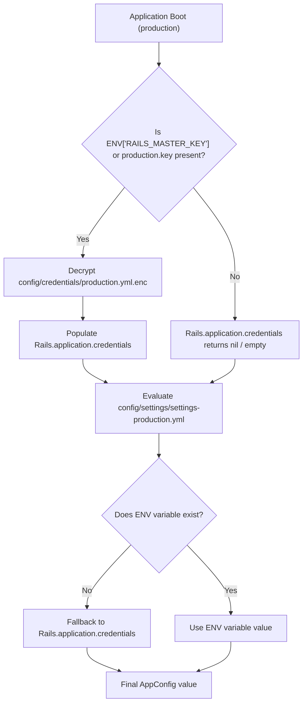

# Secrets and Credentials Management Setup

## 1. Overview

This document details the **secrets and credentials architecture** of the application, explaining how sensitive API keys, cloud credentials, and database passwords are encrypted, decrypted, and decoupled across environments.

- **Type**: Security Infrastructure / Secrets Management.
- **Problem Solved**:
  - Prevents credential leaks in source code repositories.
  - Supports multi-environment credentials (`development`, `test`, `production`) with separate encryption keys.
  - Allows hybrid deployment models: cloud environment variables can override encrypted credentials without re-encrypting files.
- **Project Choice**: Multi-environment **Rails Encrypted Credentials** (`config/credentials/*.yml.enc`) with strict `.gitignore` key protection and environment variable precedence.

---

## 2. Historical Timeline

| Commit | Date | Author / Context | Files Changed | Technical Change Introduced |
| :--- | :--- | :--- | :--- | :--- |
| [`be0edb0`](file:///home/devendra/work/App) | 2026-09-29 | Rails New | `config/master.key`, `config/credentials.yml.enc` | Standard single-file Rails credentials generated. |
| [`6d158c9`](file:///home/devendra/work/App) | 2026-10-02 | Multi-Environment Split | `config/credentials/`, `.gitignore` | Migrated from single `credentials.yml.enc` to multi-environment credentials (`development.yml.enc`, `test.yml.enc`, `production.yml.enc`). Enforced `.gitignore` patterns preventing any `.key` file from being committed. |
| [`9428295`](file:///home/devendra/work/App) | 2026-10-05 | Production Storage Secrets | `config/settings/settings-production.yml` | Added AWS S3 credential fallback hierarchy (`ENV["AWS_ACCESS_KEY_ID"].presence || Rails.application&.credentials&.dig(:aws, :access_key_id)`). |
| [`4d45698`](file:///home/devendra/work/App) | 2026-10-06 | Production Mailer Secrets | `config/settings/settings-production.yml` | Added SMTP credential fallback hierarchy for email delivery relays. |

---

## 3. Why This Setup Was Introduced

- **Verified Reason**: Supported by comprehensive conversation history (transcript steps 311–331). The team evaluated external secret management tools (Doppler, AWS Systems Manager Parameter Store, Chamber, Vault). In step 331, the explicit architectural decision was reached: *"For now lets use the Rails Encrypted Credentials for each environment"*.
- **Technical Explanation**: A single `config/master.key` shared across development, staging, and production is a security anti-pattern because giving a developer access to the development key grants them ability to decrypt production secrets. Rails multi-environment credentials generate separate keypairs:
  - `config/credentials/development.key`
  - `config/credentials/test.key`
  - `config/credentials/production.key`
- **Hybrid Cloud Precedence**: In containerized deployments (Docker, ECS, Kubernetes), cloud platform secrets managers often inject secrets directly as environment variables. The application architecture establishes this priority:
  1. **Environment Variable** (highest precedence — allows instant rotation without rebuilding images).
  2. **Encrypted Credentials** (fallback — allows standalone boot with only `RAILS_MASTER_KEY`).
  3. **Development Default** (lowest precedence — e.g. `localhost`).

---

## 4. Files and Configuration Explained

### 1. Key Storage and `.gitignore` Rules: [`.gitignore`](file:///home/devendra/work/App/.gitignore#L35-L38)
```gitignore
# Ignore key files for decrypting credentials and more.
/config/*.key
/config/credentials/*.key
```
- **Guarantees**: Encryption keys NEVER touch the Git tree. Even if a developer creates a key in `config/` or `config/credentials/`, Git ignores it.

### 2. Multi-Environment Credentials Structure
```text
config/credentials/
├── development.key       (Local only, gitignored)
├── development.yml.enc   (Committed)
├── test.key              (Local/CI only, gitignored)
├── test.yml.enc          (Committed)
├── production.key        (Production/vault only, gitignored)
└── production.yml.enc    (Committed)
```

### 3. Decoupled Production Configuration: [`config/settings/settings-production.yml`](file:///home/devendra/work/App/config/settings/settings-production.yml)
Notice the safe navigation (`&.`) pattern preventing boot crashes if a key is not supplied:
```yaml
app_host: <%= ENV["APP_HOST"].presence || Rails.application&.credentials&.dig(:app_host) %>

redis:
  url: <%= ENV["REDIS_URL"].presence || Rails.application&.credentials&.dig(:redis, :url) %>

database:
  host: <%= ENV["DATABASE_HOST"].presence || Rails.application&.credentials&.dig(:database, :host) %>
  port: <%= ENV["DATABASE_PORT"].presence || Rails.application&.credentials&.dig(:database, :port) || 5432 %>
  username: <%= ENV["DATABASE_USERNAME"].presence || Rails.application&.credentials&.dig(:database, :username) %>
  password: <%= ENV["DATABASE_PASSWORD"].presence || Rails.application&.credentials&.dig(:database, :password) %>
  name: <%= ENV["DATABASE_NAME"].presence || Rails.application&.credentials&.dig(:database, :name) %>

mailer:
  address: <%= ENV["SMTP_ADDRESS"].presence || Rails.application&.credentials&.dig(:smtp, :address) %>
  port: <%= ENV["SMTP_PORT"].presence || Rails.application&.credentials&.dig(:smtp, :port) %>
  domain: <%= ENV["SMTP_DOMAIN"].presence || Rails.application&.credentials&.dig(:smtp, :domain) %>
  user_name: <%= ENV["SMTP_USER_NAME"].presence || Rails.application&.credentials&.dig(:smtp, :user_name) %>
  password: <%= ENV["SMTP_PASSWORD"].presence || Rails.application&.credentials&.dig(:smtp, :password) %>
  authentication: <%= ENV["SMTP_AUTHENTICATION"].presence || Rails.application&.credentials&.dig(:smtp, :authentication) %>
  sender_email: <%= ENV["MAILER_SENDER_EMAIL"].presence || Rails.application&.credentials&.dig(:mailer, :sender_email) || Rails.application&.credentials&.dig(:smtp, :from_email) %>

aws:
  access_key_id: <%= ENV["AWS_ACCESS_KEY_ID"].presence || Rails.application&.credentials&.dig(:aws, :access_key_id) %>
  secret_access_key: <%= ENV["AWS_SECRET_ACCESS_KEY"].presence || Rails.application&.credentials&.dig(:aws, :secret_access_key) %>
  region: <%= ENV["AWS_REGION"].presence || Rails.application&.credentials&.dig(:aws, :region) || "us-east-1" %>
  bucket: <%= ENV["AWS_BUCKET"].presence || Rails.application&.credentials&.dig(:aws, :bucket) %>
  endpoint: <%= ENV["AWS_ENDPOINT"].presence || Rails.application&.credentials&.dig(:aws, :endpoint) %>
```

---

## 5. Dependencies and Prerequisites

- **Rails ActiveSupport MessageEncryptor**: AES-256-GCM encryption built into Rails.
- **Editor**: System editor configured (`EDITOR=vim` or `EDITOR=nano`) for `rails credentials:edit`.
- **Production Decryption Key**: Either:
  - File: `config/credentials/production.key` placed securely on the server, OR
  - Environment variable: `RAILS_MASTER_KEY` / `RAILS_CREDENTIALS_KEY`.

---

## 6. How the Setup Works



---

## 7. How to Reproduce the Setup

### Step 1: Ensure Key Files are Gitignored
In `.gitignore`:
```gitignore
/config/*.key
/config/credentials/*.key
```

### Step 2: Generate Multi-Environment Credentials
Run:
```bash
# Generate development credentials
EDITOR=vim bin/rails credentials:edit --environment development

# Generate test credentials
EDITOR=vim bin/rails credentials:edit --environment test

# Generate production credentials
EDITOR=vim bin/rails credentials:edit --environment production
```

### Step 3: Configure Hybrid Fallback in Settings
Structure `config/settings/settings-production.yml` using the safe navigation pattern:
```yaml
aws:
  access_key_id: <%= ENV["AWS_ACCESS_KEY_ID"].presence || Rails.application&.credentials&.dig(:aws, :access_key_id) %>
  secret_access_key: <%= ENV["AWS_SECRET_ACCESS_KEY"].presence || Rails.application&.credentials&.dig(:aws, :secret_access_key) %>
```

---

## 8. Verification and Operational Notes

| Verification Check | Target | Execution Command | Expected Output | Status |
| :--- | :--- | :--- | :--- | :--- |
| **Git Key Protection** | Git | `git status --ignored \| grep "\.key"` | Lists `.key` files under Ignored | Executed & Verified |
| **Development Credential Decryption** | Host | `bin/rails runner -e development "puts Rails.application.credentials.present?"` | `true` | Executed & Verified |
| **Safe Boot Without Production Key** | Host | `RAILS_ENV=production DATABASE_HOST=localhost REDIS_URL=redis://localhost:6379/0 bin/rails runner "puts 'Boots safely without production.key'"` | `Boots safely without production.key` | Executed & Verified |
| **ENV Priority Override** | Host | `AWS_REGION=eu-central-1 bin/rails runner -e production "puts AppConfig.dig(:aws, :region)"` | `eu-central-1` | Executed & Verified |

---

## 9. Current Status and Recommendations

- **Current Status**: Secure, modular, zero credentials exposed, fully protected by `.gitignore`.
- **Recommendations**:
  - Never commit `.key` files under any circumstances.
  - Store `production.key` in a secure team password manager (e.g., 1Password, Bitwarden) or cloud KMS.
  - In Docker/Kubernetes production deployments, prefer passing secrets via cloud provider secret injectors (e.g. AWS Secrets Manager to ECS task environment) to simplify key rotation.

---

## 10. References

- **Git Commits**:
  - Initial creation: [`be0edb0`](file:///home/devendra/work/App)
  - Multi-environment split: [`6d158c9`](file:///home/devendra/work/App)
  - Production settings fallback: [`9428295`](file:///home/devendra/work/App), [`4d45698`](file:///home/devendra/work/App)
- **Files**:
  - [`.gitignore`](file:///home/devendra/work/App/.gitignore)
  - [`config/settings/settings-production.yml`](file:///home/devendra/work/App/config/settings/settings-production.yml)
- **Brain Artifact Reference**:
  - [`credentials_and_secrets_architecture_guide.md`](file:///home/devendra/.gemini/antigravity-cli/brain/542eecbf-173e-427b-b3b1-098927b3317d/credentials_and_secrets_architecture_guide.md)
- **External Documentation**:
  - [Rails Encrypted Credentials Guide](https://guides.rubyonrails.org/security.html#custom-credentials)
