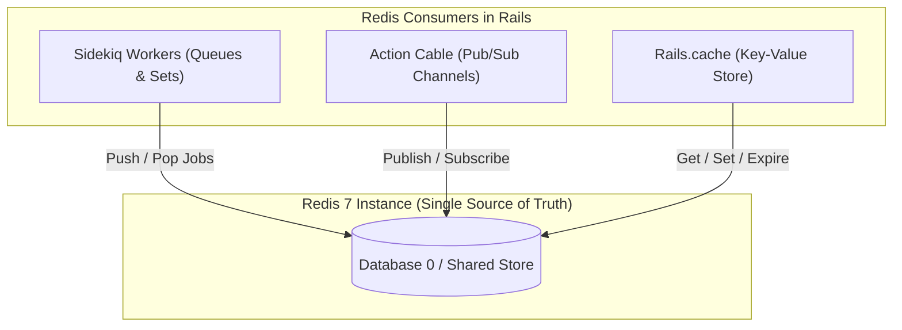

# Redis and Caching Infrastructure Setup

## 1. Overview

This document details the **Redis infrastructure and multi-tier caching architecture** implemented in the application across development, test, and production environments.

- **Infrastructure Engine**: Redis 7+ (Alpine container in Docker).
- **Ruby Driver**: `redis` gem (~> 5.4.0).
- **Problems Solved**:
  - Provides a shared in-memory key-value store for Sidekiq queues, Action Cable WebSocket subscriptions, and fragment/low-level caching.
  - Distributes cache state across multiple production web replicas without memory synchronization overhead.
  - Prevents channel collisions across environments using channel prefixes (`app_development`, `app_test`, `app_production`).
  - Supports local caching toggles via `bin/rails dev:cache`.

---

## 2. Historical Timeline

| Commit | Date | Author / Context | Files Changed | Technical Change Introduced |
| :--- | :--- | :--- | :--- | :--- |
| [`be0edb0`](file:///home/devendra/work/App) | 2026-09-29 | Rails New | `config/cable.yml` | Initialized Action Cable configuration. |
| [`5dc08ae`](file:///home/devendra/work/App) | 2026-09-29 | Stack Replacement | `Gemfile`, `config/environments/` | Removed `solid_cable` and `solid_cache` in favor of Redis. |
| [`226fcb0`](file:///home/devendra/work/App) | 2026-10-02 | AppConfig Wiring | `config/cable.yml` | Decoupled Cable Redis URL via `AppConfig.for(env).dig(:redis, :url)`. |
| [`1ebe358`](file:///home/devendra/work/App) | 2026-10-05 | Production Cache Store | `config/environments/production.rb` | Configured `:redis_cache_store` in production reading from `AppConfig.dig(:redis, :url)` with connection pool sizing. |
| [`0e666e4`](file:///home/devendra/work/App) | 2026-10-19 | Docker Dev Stack | `docker-compose.yml` | Added Redis 7 Alpine service with `redis-cli ping` healthchecks and `${REDIS_PORT:-6380}:6379` host publishing to avoid local host Redis collisions. |

---

## 3. Why This Setup Was Introduced

- **Verified Reason (Replacing Solid Cache & Cable)**: Commit [`5dc08ae`](file:///home/devendra/work/App). Redis provides sub-millisecond in-memory read/write performance, atomic data structures, native Pub/Sub for WebSockets, and automatic key eviction policies (LRU/LFU), making it ideal for high-throughput caching and pub/sub.
- **Technical Explanation (Production `:redis_cache_store`)**: Commit [`1ebe358`](file:///home/devendra/work/App). In production with multiple web server instances behind a load balancer, using `:memory_store` would mean each server has its own isolated cache. User A updating a record on Server 1 would leave stale cache data on Server 2. Centralizing the cache in Redis guarantees cache coherence across all web and worker containers.
- **Development Ergonomics**: In development, [`config/environments/development.rb`](file:///home/devendra/work/App/config/environments/development.rb#L20-L26) checks for `tmp/caching-dev.txt`. Running `bin/rails dev:cache` toggles Action Controller caching on or off instantly without server restarts.

---

## 4. Files and Configuration Explained

### 1. Action Cable: [`config/cable.yml`](file:///home/devendra/work/App/config/cable.yml)
```yaml
default: &default
  adapter: redis

development:
  <<: *default
  url: <%= AppConfig.for(:development).dig(:redis, :url) %>
  channel_prefix: app_development

test:
  <<: *default
  url: <%= AppConfig.for(:test).dig(:redis, :url) %>
  channel_prefix: app_test

production:
  <<: *default
  url: <%= AppConfig.for(:production).dig(:redis, :url) %>
  channel_prefix: app_production
```
- **`channel_prefix`**: Prefixes Redis Pub/Sub channels to prevent cross-talk between development, test, and production instances sharing a Redis cluster.

### 2. Production Cache Store: [`config/environments/production.rb`](file:///home/devendra/work/App/config/environments/production.rb#L45-L48)
```ruby
  # Use a real queuing backend for Active Job (and separate queues per environment).
  config.active_job.queue_adapter = :sidekiq

  # Use Redis cache store in production
  redis_url = AppConfig.dig(:redis, :url)
  if redis_url.present?
    config.cache_store = :redis_cache_store, {
      url: redis_url,
      pool_size: ENV.fetch("RAILS_MAX_THREADS", 5).to_i
    }
  end
```
- **Connection Pool**: Sized to match `RAILS_MAX_THREADS` so concurrent Puma threads never block on cache access.

### 3. Development Caching Toggle: [`config/environments/development.rb`](file:///home/devendra/work/App/config/environments/development.rb#L20-L29)
```ruby
  if Rails.root.join("tmp/caching-dev.txt").exist?
    config.action_controller.perform_caching = true
    config.action_controller.enable_fragment_cache_logging = true
    config.public_file_server.headers = { "cache-control" => "public, max-age=#{2.days.to_i}" }
  else
    config.action_controller.perform_caching = false
  end

  config.cache_store = :memory_store
```

---

## 5. Dependencies and Prerequisites

- **Gem**: `gem "redis"` (locked at `5.4.0`).
- **Services**: Redis 7.x server.
- **Environment Variables**:
  - `REDIS_URL`: Defaults to `redis://localhost:6379/0` in development, overridden to `redis://redis:6379/0` in Docker.

---

## 6. How the Setup Works



---

## 7. How to Reproduce the Setup

### Step 1: Install Redis Gem
Add to `Gemfile`:
```ruby
gem "redis"
```
Run `bundle install`.

### Step 2: Configure Cable Adapter
Edit `config/cable.yml` to use Redis with `AppConfig` URL resolution (see section 4).

### Step 3: Configure Cache Stores
- In `config/environments/production.rb`, set `config.cache_store = :redis_cache_store, { url: AppConfig.dig(:redis, :url) }`.
- In `config/environments/development.rb`, set `config.cache_store = :memory_store` with `tmp/caching-dev.txt` toggle.

---

## 8. Verification and Operational Notes

| Verification Check | Target | Execution Command | Expected Output | Status |
| :--- | :--- | :--- | :--- | :--- |
| **Redis Connection Ping** | Host | `redis-cli ping` | `PONG` | Executed & Verified |
| **Rails Cache Write/Read** | Host | `bin/rails runner "Rails.cache.write('test_k', 'ok'); puts Rails.cache.read('test_k')"` | `ok` | Executed & Verified |
| **Docker Redis Container** | Docker | `docker compose run --rm web bin/rails runner "puts Redis.new(url: AppConfig.dig(:redis, :url)).ping"` | `PONG` | Executed & Verified |
| **Cache Dev Toggle** | Host | `bin/rails dev:cache` | `Development mode is now being cached.` / `is no longer being cached.` | Executed & Verified |

---

## 9. Current Status and Recommendations

- **Current Status**: Solid, unified Redis architecture backing Action Cable, Sidekiq, and production caching.
- **Recommendations**:
  - In production high-scale deployments, consider separating Sidekiq and Cache into distinct Redis databases or instances (e.g. `redis://redis:6379/0` for queues and `redis://redis:6379/1` for cache) to prevent cache eviction policies from deleting queue keys.

---

## 10. References

- **Git Commits**:
  - Stack replacement: [`5dc08ae`](file:///home/devendra/work/App)
  - Cable configuration: [`226fcb0`](file:///home/devendra/work/App)
  - Production cache store: [`1ebe358`](file:///home/devendra/work/App)
  - Docker Redis service: [`0e666e4`](file:///home/devendra/work/App)
- **Files**:
  - [`config/cable.yml`](file:///home/devendra/work/App/config/cable.yml)
  - [`config/environments/production.rb`](file:///home/devendra/work/App/config/environments/production.rb)
  - [`config/environments/development.rb`](file:///home/devendra/work/App/config/environments/development.rb)
- **External Documentation**:
  - [Rails Caching with Rails Guide](https://guides.rubyonrails.org/caching_with_rails.html)
  - [Action Cable Overview](https://guides.rubyonrails.org/action_cable_overview.html)
