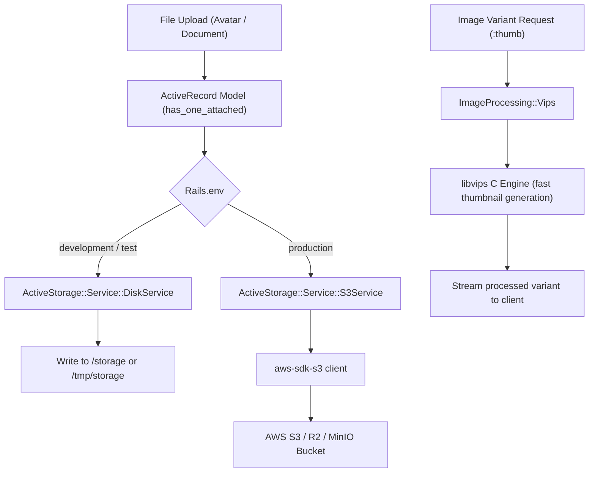

# File Storage and Active Storage Setup

## 1. Overview

This document explains the **file attachment and cloud object storage architecture** configured in this application using Rails **Active Storage**, **AWS S3**, and **libvips**.

- **Framework**: Rails Active Storage.
- **Engines**: Local disk in development/test, AWS S3 (or S3-compatible storage like MinIO, Cloudflare R2, Wasabi) in production.
- **Image Processing**: `image_processing` gem (~> 1.2) backed by the high-performance `libvips` C library.
- **Problems Solved**:
  - Eliminates ephemeral container data loss in production by strictly enforcing cloud object persistence.
  - Prevents slow image rendering and memory bloat using fast, low-memory VIPS processing.
  - Supports custom S3 endpoints for private cloud or local testing.

---

## 2. Historical Timeline

| Commit | Date | Author / Context | Files Changed | Technical Change Introduced |
| :--- | :--- | :--- | :--- | :--- |
| [`be0edb0`](file:///home/devendra/work/App) | 2026-09-29 | Rails New | `config/storage.yml` | Initialized default Active Storage configuration boilerplate. |
| [`9428295`](file:///home/devendra/work/App) | 2026-10-05 | S3 Storage Addition | `Gemfile`, `config/storage.yml`, `config/environments/production.rb` | Added `aws-sdk-s3` gem. Configured `:amazon` service in `config/storage.yml` reading credentials from `AppConfig.dig(:aws)`. Initially used a conditional fallback to `:local` disk in production. |
| [`d4cbc43`](file:///home/devendra/work/App) | 2026-10-13 | Audit Remediation (MED-02) | `config/environments/production.rb` | Removed the dangerous fallback to `:local` disk in production. Enforced `config.active_storage.service = :amazon` unconditionally. |

---

## 3. Why This Setup Was Introduced

- **Verified Reason (Enforcing `:amazon` in Production - MED-02)**: Detailed in the technical audit (`fund/audit/01-findings.md` Finding **MED-02**) and resolved in commit [`d4cbc43`](file:///home/devendra/work/App). The original production configuration had:
  ```ruby
  # DANGEROUS OBSOLETE CONFIGURATION:
  config.active_storage.service = AppConfig.dig(:aws, :bucket).present? ? :amazon : :local
  ```
  If production containers booted with a missing or misspelled AWS environment variable, Active Storage silently switched to `:local` disk inside the container. When the container was redeployed or rescheduled, all customer-uploaded avatars, attachments, and documents were permanently lost. Forcing `:amazon` in production ensures the container fails fast during deployment if cloud storage credentials are misconfigured.
- **Technical Explanation (`libvips` vs `ImageMagick`)**: Active Storage defaults to `libvips` in modern Rails. VIPS is up to 10x faster and consumes up to 10x less memory than ImageMagick when generating image thumbnails and variants. Both production and development Dockerfiles install `libvips` at the OS layer.

---

## 4. Files and Configuration Explained

### 1. Active Storage Services: [`config/storage.yml`](file:///home/devendra/work/App/config/storage.yml)
```yaml
test:
  service: Disk
  root: <%= Rails.root.join("tmp/storage") %>

local:
  service: Disk
  root: <%= Rails.root.join("storage") %>

amazon:
  service: S3
  access_key_id: <%= AppConfig.for(:production).dig(:aws, :access_key_id) %>
  secret_access_key: <%= AppConfig.for(:production).dig(:aws, :secret_access_key) %>
  region: <%= AppConfig.for(:production).dig(:aws, :region) || "us-east-1" %>
  bucket: <%= AppConfig.for(:production).dig(:aws, :bucket) %>
  endpoint: <%= AppConfig.for(:production).dig(:aws, :endpoint) %>
  force_path_style: <%= AppConfig.for(:production).dig(:aws, :endpoint).present? %>
```
- **`endpoint` & `force_path_style`**: Supports custom S3 endpoints (MinIO, Cloudflare R2, LocalStack) seamlessly.

### 2. Production Environment Enforcement: [`config/environments/production.rb`](file:///home/devendra/work/App/config/environments/production.rb#L41-L43)
```ruby
  # Store files in AWS S3 or S3-compatible cloud storage (see config/storage.yml for options).
  # Enforce :amazon service in production to prevent silent data loss on ephemeral container disks
  config.active_storage.service = :amazon
```

### 3. Development Environment Configuration: [`config/environments/development.rb`](file:///home/devendra/work/App/config/environments/development.rb#L31-L32)
```ruby
  # Store uploaded files on the local file system (see config/storage.yml for options).
  config.active_storage.service = :local
```

---

## 5. Dependencies and Prerequisites

- **Gems**:
  - `gem "aws-sdk-s3", require: false` (locked at `1.171.0`)
  - `gem "image_processing", "~> 1.2"` (locked at `1.13.0`)
- **System Package**: `libvips` (installed in Debian Bookworm base).
- **Production Credentials**: Configured via `AWS_ACCESS_KEY_ID`, `AWS_SECRET_ACCESS_KEY`, `AWS_REGION`, and `AWS_BUCKET`.

---

## 6. How the Setup Works



---

## 7. How to Reproduce the Setup

### Step 1: Install Dependencies
In `Gemfile`:
```ruby
gem "image_processing", "~> 1.2"
gem "aws-sdk-s3", require: false
```
Run `bundle install`.

### Step 2: Configure `config/storage.yml`
Define `:local`, `:test`, and `:amazon` services (see section 4).

### Step 3: Enforce Storage Services per Environment
- In `config/environments/development.rb`: `config.active_storage.service = :local`
- In `config/environments/test.rb`: `config.active_storage.service = :test`
- In `config/environments/production.rb`: `config.active_storage.service = :amazon` (strictly, without local fallback).

---

## 8. Verification and Operational Notes

| Verification Check | Target | Execution Command | Expected Output | Status |
| :--- | :--- | :--- | :--- | :--- |
| **Development Storage Service** | Host | `bin/rails runner "puts Rails.configuration.active_storage.service"` | `local` | Executed & Verified |
| **Production Storage Service** | Host | `RAILS_ENV=production DATABASE_HOST=localhost REDIS_URL=redis://localhost:6379/0 bin/rails runner "puts Rails.configuration.active_storage.service"` | `amazon` | Executed & Verified |
| **VIPS Processor Active** | Host | `bin/rails runner "puts ActiveStorage.variant_processor"` | `:vips` | Executed & Verified |
| **libvips Library in Docker** | Docker | `docker compose run --rm web vips -v` | `vips-8.15.1 ...` | Executed & Verified |

---

## 9. Current Status and Recommendations

- **Current Status**: Enforces strict cloud object persistence in production with fast VIPS image processing.
- **Recommendations**:
  - When configuring your AWS S3 bucket in production, enable CORS on the bucket if planning direct uploads from browsers (`ActiveStorage.DirectUpload`).
  - Configure lifecycle rules on the S3 bucket to automatically abort incomplete multipart uploads after 7 days.

---

## 10. References

- **Git Commits**:
  - Initial configuration: [`be0edb0`](file:///home/devendra/work/App)
  - S3 introduction: [`9428295`](file:///home/devendra/work/App)
  - Production service enforcement (MED-02): [`d4cbc43`](file:///home/devendra/work/App)
- **Files**:
  - [`config/storage.yml`](file:///home/devendra/work/App/config/storage.yml)
  - [`config/environments/production.rb`](file:///home/devendra/work/App/config/environments/production.rb)
  - [`config/environments/development.rb`](file:///home/devendra/work/App/config/environments/development.rb)
- **External Documentation**:
  - [Active Storage Overview](https://guides.rubyonrails.org/active_storage_overview.html)
  - [libvips Official Documentation](https://www.libvips.org/)
