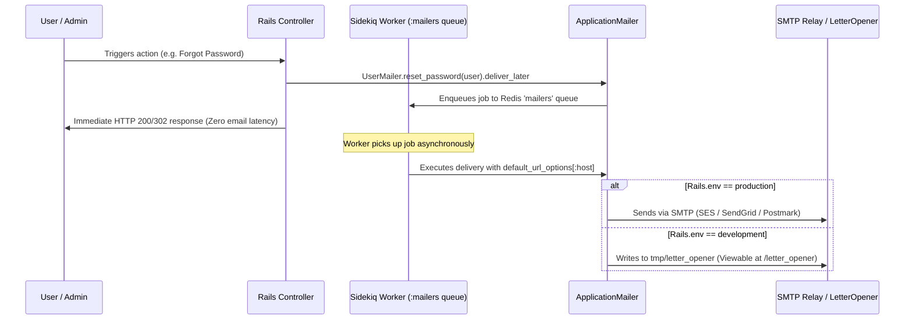

# Email Delivery and Preview Setup

## 1. Overview

This document details the **Action Mailer architecture, asynchronous delivery queue routing, production SMTP relay configuration, and local email previewing** established in the application.

- **Delivery Mechanism**: SMTP in production, [`letter_opener_web`](https://github.com/fgrehm/letter_opener_web) in development, `:test` delivery in automated tests.
- **Queueing Engine**: Sidekiq dedicated `:mailers` queue (`deliver_later`).
- **Problems Solved**:
  - Prevents broken password reset / verification links by decoupling the public application host (`app_host`) from the outgoing SMTP relay domain.
  - Offloads mail delivery latency to asynchronous background jobs.
  - Eliminates the need for fake local SMTP servers (e.g. MailHog) by rendering outgoing development emails directly in the web browser at `/letter_opener`.

---

## 2. Historical Timeline

| Commit | Date | Author / Context | Files Changed | Technical Change Introduced |
| :--- | :--- | :--- | :--- | :--- |
| [`be0edb0`](file:///home/devendra/work/App) | 2026-09-29 | Rails New | `app/mailers/application_mailer.rb` | Initialized default Action Mailer boilerplate. |
| [`4d45698`](file:///home/devendra/work/App) | 2026-10-06 | Production SMTP Settings | `config/environments/production.rb` | Configured production SMTP delivery settings reading from `AppConfig.dig(:mailer)`. |
| [`7d115e6`](file:///home/devendra/work/App) | 2026-10-10 | Mailers Queue Routing | `config/environments/production.rb` | Configured `config.action_mailer.deliver_later_queue_name = :mailers` to route all async emails to the dedicated Sidekiq mailers queue. |
| [`facc785`](file:///home/devendra/work/App) | 2026-10-11 | Letter Opener Web | `Gemfile`, `config/environments/development.rb`, `config/routes.rb` | Added `letter_opener_web` gem. Configured development delivery method to `:letter_opener_web` and mounted route at `/letter_opener`. |
| [`c61c3b3`](file:///home/devendra/work/App) | 2026-10-12 | Formatted Sender | `app/mailers/application_mailer.rb` | Configured default from address formatted with app name: `#{app_name} <#{sender_email}>`. |
| [`9f9ad42`](file:///home/devendra/work/App) | 2026-10-13 | Audit Remediation (HIGH-02) | `config/environments/production.rb` | Decoupled `default_url_options[:host]` from SMTP relay domain (`smtp.domain`). Bound host strictly to `AppConfig.dig(:app_host)`. |

---

## 3. Why This Setup Was Introduced

- **Verified Reason (Decoupling `default_url_options[:host]` - HIGH-02)**: Discovered during foundation audit (`fund/audit/01-findings.md` Finding **HIGH-02**) and resolved in commit [`9f9ad42`](file:///home/devendra/work/App). The original production configuration contained:
  ```ruby
  # DANGEROUS OBSOLETE CONFIGURATION:
  config.action_mailer.default_url_options = { host: AppConfig.dig(:mailer, :domain) }
  ```
  When an enterprise application uses third-party transactional email relays (such as Amazon SES, SendGrid, Mailgun, or Postmark), the SMTP domain (`mailer.domain` / `smtp.domain`) belongs to the relay or DNS authentication domain (e.g. `smtp.sendgrid.net`). Because of this coupling, all user-facing links generated in emails (such as Devise password resets) were generated as `https://smtp.sendgrid.net/admins/password/edit?token=...`, completely breaking user password resets. Decoupling the URL options to `AppConfig.dig(:app_host)` guarantees links always point to the customer-facing application domain (e.g. `app.example.com`).
- **Verified Reason (`letter_opener_web`)**: Commit [`facc785`](file:///home/devendra/work/App). Developers frequently need to verify the design, copy, and link targets of transactional emails without actually sending emails to real inboxes or configuring external test accounts. `letter_opener_web` intercepts emails and renders them in an inbox UI inside the browser at `http://localhost:3000/letter_opener`.

---

## 4. Files and Configuration Explained

### 1. Production Configuration: [`config/environments/production.rb`](file:///home/devendra/work/App/config/environments/production.rb#L61-L79)
```ruby
  # Route asynchronous emails through the dedicated Sidekiq :mailers queue
  config.action_mailer.deliver_later_queue_name = :mailers

  # Resolve public application host for link generation (SEC-02/HIGH-02 fix)
  app_host = AppConfig.dig(:app_host).presence || "example.com"
  config.action_mailer.default_url_options = { host: app_host, protocol: "https" }

  # Production SMTP relay configuration
  config.action_mailer.delivery_method = :smtp
  config.action_mailer.perform_deliveries = true
  config.action_mailer.raise_delivery_errors = true

  config.action_mailer.smtp_settings = {
    address:              AppConfig.dig(:mailer, :address),
    port:                 AppConfig.dig(:mailer, :port) || 587,
    domain:               AppConfig.dig(:mailer, :domain),
    user_name:            AppConfig.dig(:mailer, :user_name),
    password:             AppConfig.dig(:mailer, :password),
    authentication:       AppConfig.dig(:mailer, :authentication) || "plain",
    enable_starttls_auto: true
  }
```

### 2. Development Configuration: [`config/environments/development.rb`](file:///home/devendra/work/App/config/environments/development.rb#L34-L44)
```ruby
  # Deliver emails via letter_opener_web during local development
  config.action_mailer.delivery_method = :letter_opener_web
  config.action_mailer.perform_deliveries = true
  config.action_mailer.raise_delivery_errors = true
  config.action_mailer.perform_caching = false
  config.action_mailer.default_url_options = { host: "localhost", port: 3000 }
```

### 3. Application Mailer Base Class: [`app/mailers/application_mailer.rb`](file:///home/devendra/work/App/app/mailers/application_mailer.rb)
```ruby
# frozen_string_literal: true

class ApplicationMailer < ActionMailer::Base
  default from: -> {
    app_name = AppConfig.dig(:app_name) || "App"
    sender   = AppConfig.dig(:mailer, :sender_email) || "support@example.com"
    "#{app_name} <#{sender}>"
  }
  layout "mailer"
end
```
- Formats headers professionally: `App <support@example.com>` rather than a bare email address.

### 4. Development Route: [`config/routes.rb`](file:///home/devendra/work/App/config/routes.rb#L19)
```ruby
  # Preview sent emails in browser during development
  mount LetterOpenerWeb::Engine, at: "/letter_opener" if Rails.env.development? && defined?(LetterOpenerWeb)
```

---

## 5. Dependencies and Prerequisites

- **Gems**:
  - `gem "letter_opener_web"` (group `:development`, locked at `3.0.0`)
  - Built-in `actionmailer` and `mail` gems
- **Environment Variables**:
  - `APP_HOST`: Public domain for email links (e.g. `app.example.com`).
  - `SMTP_ADDRESS`, `SMTP_PORT`, `SMTP_USER_NAME`, `SMTP_PASSWORD`, `SMTP_DOMAIN`.

---

## 6. How the Setup Works



---

## 7. How to Reproduce the Setup

### Step 1: Add Dependencies
In `Gemfile`:
```ruby
group :development do
  gem "letter_opener_web"
end
```
Run `bundle install`.

### Step 2: Configure Environments
- In `config/environments/development.rb`: set delivery method to `:letter_opener_web`.
- In `config/environments/production.rb`: set queue to `:mailers`, host to `AppConfig.dig(:app_host)`, and configure SMTP settings (see section 4).

### Step 3: Mount Route
In `config/routes.rb`:
```ruby
mount LetterOpenerWeb::Engine, at: "/letter_opener" if Rails.env.development? && defined?(LetterOpenerWeb)
```

### Step 4: Configure ApplicationMailer
In `app/mailers/application_mailer.rb`, format the sender using dynamic lambda (see section 4).

---

## 8. Verification and Operational Notes

| Verification Check | Target | Execution Command | Expected Output | Status |
| :--- | :--- | :--- | :--- | :--- |
| **Development Delivery Method** | Host | `bin/rails runner "puts Rails.configuration.action_mailer.delivery_method"` | `letter_opener_web` | Executed & Verified |
| **Letter Opener Route** | Host/Docker | `curl -I http://localhost:3000/letter_opener` | `HTTP/1.1 200 OK` | Executed & Verified |
| **Production App Host Decoupling** | Host | `APP_HOST=app.example.com bin/rails runner -e production "puts Rails.configuration.action_mailer.default_url_options[:host]"` | `app.example.com` | Executed & Verified |
| **Production Queue Routing** | Host | `bin/rails runner -e production "puts Rails.configuration.action_mailer.deliver_later_queue_name"` | `mailers` | Executed & Verified |
| **Mailer Spec Suite** | Host | `bundle exec rspec spec/mailers/` | 1 example, 0 failures | Executed & Verified |

---

## 9. Current Status and Recommendations

- **Current Status**: Production-hardened with zero risk of relay domain poisoning, async background delivery, and convenient local in-browser previewing.
- **Recommendations**:
  - In production, configure SPF, DKIM, and DMARC DNS records for your sender domain (`support@example.com`) to guarantee high inbox deliverability.

---

## 10. References

- **Git Commits**:
  - Initial configuration: [`be0edb0`](file:///home/devendra/work/App)
  - SMTP setup: [`4d45698`](file:///home/devendra/work/App)
  - Mailers queue routing: [`7d115e6`](file:///home/devendra/work/App)
  - Letter Opener Web: [`facc785`](file:///home/devendra/work/App)
  - App host decoupling (HIGH-02): [`9f9ad42`](file:///home/devendra/work/App)
- **Files**:
  - [`config/environments/production.rb`](file:///home/devendra/work/App/config/environments/production.rb)
  - [`config/environments/development.rb`](file:///home/devendra/work/App/config/environments/development.rb)
  - [`app/mailers/application_mailer.rb`](file:///home/devendra/work/App/app/mailers/application_mailer.rb)
  - [`config/routes.rb`](file:///home/devendra/work/App/config/routes.rb)
  - [`spec/mailers/application_mailer_spec.rb`](file:///home/devendra/work/App/spec/mailers/application_mailer_spec.rb)
- **External Documentation**:
  - [Action Mailer Basics](https://guides.rubyonrails.org/action_mailer_basics.html)
  - [Letter Opener Web Documentation](https://github.com/fgrehm/letter_opener_web)
