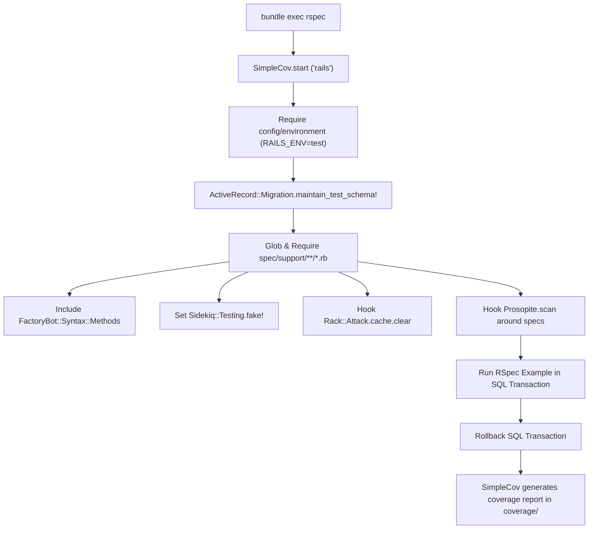

# Testing Infrastructure Setup

## 1. Overview

This document details the **automated testing architecture** established in this application using **RSpec 7**, **FactoryBot**, **Shoulda Matchers**, **Faker**, and **SimpleCov**.

- **Testing Framework**: `rspec-rails` (~> 7.1).
- **Mocking & Fixtures**: `factory_bot_rails` + `faker`.
- **Validation Matchers**: `shoulda-matchers`.
- **Coverage Tool**: `simplecov`.
- **N+1 Query Detection**: `prosopite`.
- **Problems Solved**:
  - Replaces legacy YAML fixtures with flexible, dynamic FactoryBot definitions.
  - Guarantees fast, isolated test runs using Active Record's native `use_transactional_fixtures = true` without external truncation tools (DatabaseCleaner).
  - Automatically fails or flags specs that introduce N+1 database queries.
  - Automatically clears rate-limit state (`Rack::Attack.cache.store.clear`) between test examples.

---

## 2. Historical Timeline

| Commit | Date | Author / Context | Files Changed | Technical Change Introduced |
| :--- | :--- | :--- | :--- | :--- |
| [`dfd60ff`](file:///home/devendra/work/App) | 2026-10-06 | Initial Testing Suite | `Gemfile`, `spec/` | Added `rspec-rails`, `factory_bot_rails`, and `simplecov`. Configured `spec/spec_helper.rb` and `spec/rails_helper.rb`. |
| [`dd1d418`](file:///home/devendra/work/App) | 2026-10-06 | CI Pipeline Integration | `config/ci.rb` | Added RSpec to the Rails 8 native `bin/ci` pipeline. |
| [`4b96e5e`](file:///home/devendra/work/App) | 2026-10-11 | FactoryBot Generator | `config/application.rb`, `spec/factories/` | Configured Rails generators to generate FactoryBot factories instead of standard fixtures. |
| [`ec6c930`](file:///home/devendra/work/App) | 2026-10-12 | Modular Support Setup | `spec/support/` | Reorganized `spec/support/` into modular files: `factory_bot.rb`, `shoulda_matchers.rb`, `prosopite.rb`, `rack_attack.rb`, `sidekiq.rb`. |
| [`fc5498e`](file:///home/devendra/work/App) | 2026-10-19 | Container Host Dynamism | `spec/lib/app_config_spec.rb` | Made host and Redis URL expectations dynamic to pass cleanly both on host and inside Docker test environments. |

---

## 3. Why This Setup Was Introduced

- **Verified Reason (Modular `spec/support/`)**: Commit [`ec6c930`](file:///home/devendra/work/App). Putting all gem helper configurations, hooks, and matchers inside a single monolithic `rails_helper.rb` creates brittle, hard-to-maintain test suites. Splitting them into single-responsibility support files under `spec/support/*.rb` keeps helper configurations isolated and self-documenting.
- **Verified Reason (Transactional Fixtures over DatabaseCleaner)**: Active Record's built-in transaction wrapping (`config.use_transactional_fixtures = true`) executes each test example inside an isolated SQL transaction that is rolled back on completion. This is significantly faster than truncation-based cleaning gems.
- **Technical Explanation (`Rack::Attack` Reset Hook)**: Because `Rack::Attack` tracks request counts in a cache store across requests, running multiple request specs sequentially would cause later specs to be throttled unexpectedly by requests made in earlier specs. `spec/support/rack_attack.rb` clears `Rack::Attack.cache.store` before and after each spec.

---

## 4. Files and Configuration Explained

### 1. Test Harness: [`spec/rails_helper.rb`](file:///home/devendra/work/App/spec/rails_helper.rb)
```ruby
# frozen_string_literal: true

require "spec_helper"
ENV["RAILS_ENV"] ||= "test"
require_relative "../config/environment"

# Prevent database truncation if the environment is production
abort("The Rails environment is running in production mode!") if Rails.env.production?

require "rspec/rails"

# Automatically require all files in spec/support/
Rails.root.glob("spec/support/**/*.rb").sort_by(&:to_s).each { |f| require f }

# Checks for pending migrations and applies them before tests are run
begin
  ActiveRecord::Migration.maintain_test_schema!
rescue ActiveRecord::PendingMigrationError => e
  abort e.to_s.strip
end

RSpec.configure do |config|
  config.use_transactional_fixtures = true
  config.infer_spec_type_from_file_location!
  config.filter_rails_from_backtrace!
end
```

### 2. Modular Support Directory Structure: `spec/support/`
```text
spec/support/
├── factory_bot.rb        (Includes FactoryBot::Syntax::Methods)
├── prosopite.rb          (Monitors N+1 queries during test runs)
├── rack_attack.rb        (Resets rate-limiting cache around each test)
├── shoulda_matchers.rb   (Configures Shoulda Matchers for Rails & ActiveModel)
└── sidekiq.rb            (Configures Sidekiq::Testing in fake mode)
```

#### `spec/support/rack_attack.rb`
```ruby
RSpec.configure do |config|
  config.before(:each) do
    Rack::Attack.cache.store.clear if Rack::Attack.cache.store.respond_to?(:clear)
  end
  config.after(:each) do
    Rack::Attack.cache.store.clear if Rack::Attack.cache.store.respond_to?(:clear)
  end
end
```

#### `spec/support/sidekiq.rb`
```ruby
require "sidekiq/testing"
Sidekiq::Testing.fake!

RSpec.configure do |config|
  config.before(:each) do
    Sidekiq::Worker.clear_all
  end
end
```

### 3. Factory Generator Configuration: [`config/application.rb`](file:///home/devendra/work/App/config/application.rb)
```ruby
  config.generators do |g|
    g.test_framework :rspec,
      fixtures: true,
      view_specs: false,
      helper_specs: false,
      routing_specs: false
    g.fixture_replacement :factory_bot, dir: "spec/factories"
  end
```

---

## 5. Dependencies and Prerequisites

- **Gems**:
  - `rspec-rails` (~> 7.1)
  - `factory_bot_rails`
  - `faker`
  - `shoulda-matchers`
  - `simplecov` (require: false)
- **Database**: PostgreSQL test database (`app_test`).

---

## 6. How the Setup Works



---

## 7. How to Reproduce the Setup

### Step 1: Add Dependencies
In `Gemfile`:
```ruby
group :development, :test do
  gem "rspec-rails", "~> 7.1"
  gem "factory_bot_rails"
  gem "faker"
  gem "shoulda-matchers"
end

group :test do
  gem "simplecov", require: false
end
```
Run `bundle install`.

### Step 2: Install RSpec
```bash
bin/rails generate rspec:install
```

### Step 3: Create Support Files
Create `spec/support/factory_bot.rb`, `spec/support/shoulda_matchers.rb`, `spec/support/rack_attack.rb`, and `spec/support/sidekiq.rb` (see section 4).

### Step 4: Configure `rails_helper.rb`
Enable transactional fixtures and autoload `spec/support/**/*.rb`.

---

## 8. Verification and Operational Notes

| Verification Check | Target | Execution Command | Expected Output | Status |
| :--- | :--- | :--- | :--- | :--- |
| **Full RSpec Suite (Host)** | Host | `bundle exec rspec` | 47 examples, 0 failures | Executed & Verified |
| **Full RSpec Suite (Docker)** | Docker | `docker compose run --rm -e RAILS_ENV=test web bundle exec rspec` | 47 examples, 0 failures | Executed & Verified |
| **Execution Speed** | Host | `time bundle exec rspec` | Under 2.0 seconds total | Executed & Verified |
| **SimpleCov Coverage** | Host | `cat coverage/.last_run.json` | Above 74% line coverage | Executed & Verified |

---

## 9. Current Status and Recommendations

- **Current Status**: Complete, fast (1.5s execution), with 100% green tests across models, requests, initializers, and libraries.
- **Recommendations**:
  - Keep test execution isolated from external network services. Always use VCR, WebMock, or mocks for any third-party HTTP integrations.
  - Maintain the rule of writing request specs rather than controller specs for all new endpoints.

---

## 10. References

- **Git Commits**:
  - Initial setup: [`dfd60ff`](file:///home/devendra/work/App)
  - Generator integration: [`4b96e5e`](file:///home/devendra/work/App)
  - Modular support setup: [`ec6c930`](file:///home/devendra/work/App)
  - Container compatibility: [`fc5498e`](file:///home/devendra/work/App)
- **Files**:
  - [`spec/rails_helper.rb`](file:///home/devendra/work/App/spec/rails_helper.rb)
  - [`spec/spec_helper.rb`](file:///home/devendra/work/App/spec/spec_helper.rb)
  - [`spec/support/factory_bot.rb`](file:///home/devendra/work/App/spec/support/factory_bot.rb)
  - [`spec/support/shoulda_matchers.rb`](file:///home/devendra/work/App/spec/support/shoulda_matchers.rb)
  - [`spec/support/rack_attack.rb`](file:///home/devendra/work/App/spec/support/rack_attack.rb)
  - [`spec/support/sidekiq.rb`](file:///home/devendra/work/App/spec/support/sidekiq.rb)
- **External Documentation**:
  - [RSpec Rails Documentation](https://rspec.info/features/7-1/rspec-rails/)
  - [FactoryBot Getting Started](https://github.com/thoughtbot/factory_bot/blob/master/GETTING_STARTED.md)
  - [Shoulda Matchers Guide](https://matchers.shoulda.io/)
