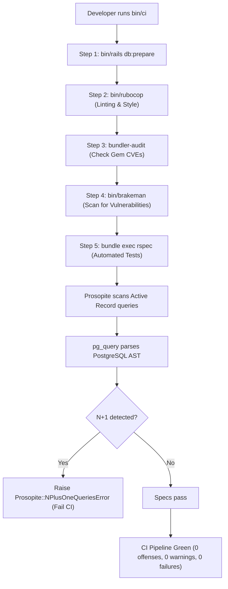

# Code Quality, Security Scanning, and Performance Setup

## 1. Overview

This document details the **automated code quality, security vulnerability scanning, performance optimization, and local CI pipeline** configured in this application.

- **Style Enforcement**: `rubocop-rails-omakase`.
- **Security Scanners**: `brakeman` (AST static analysis) and `bundler-audit` (CVE database auditing).
- **N+1 Query Detection**: `prosopite` + `pg_query` (AST PostgreSQL query fingerprinting).
- **Pagination**: `pagy` (v43 lightweight pagination).
- **Local CI Pipeline**: Rails 8 native `bin/ci` and `config/ci.rb`.
- **Problems Solved**:
  - Prevents security vulnerabilities (SQL injection, XSS, insecure direct object references, vulnerable gems) before code reaches production.
  - Automatically flags N+1 query regressions during local development, test runs, and background job processing.
  - Standardizes Ruby syntax without bikeshedding using official Rails Omakase styling.
  - Consolidates all verification steps into a single unified command (`bin/ci`).

---

## 2. Historical Timeline

| Commit | Date | Author / Context | Files Changed | Technical Change Introduced |
| :--- | :--- | :--- | :--- | :--- |
| [`be0edb0`](file:///home/devendra/work/App) | 2026-09-29 | Rails New | `.rubocop.yml`, `bin/rubocop`, `bin/brakeman` | Added RuboCop Rails Omakase and Brakeman. |
| [`dd1d418`](file:///home/devendra/work/App) | 2026-10-06 | CI Pipeline Integration | `config/ci.rb` | Added RSpec and resolved initial RuboCop and Brakeman checks in the native Rails 8 `bin/ci` workflow. |
| [`1cd83ba`](file:///home/devendra/work/App) | 2026-10-11 | Pagination Setup | `Gemfile`, `config/initializers/pagy.rb` | Added `pagy` gem and configured initialization options (overflow handling, default page size of 20 items). |
| [`1953432`](file:///home/devendra/work/App) | 2026-10-12 | N+1 Query Detection | `Gemfile`, `config/initializers/prosopite.rb`, `spec/support/prosopite.rb` | Added `prosopite` and `pg_query`. Configured automated N+1 detection in development logging, Sidekiq middleware, and test suites. |

---

## 3. Why This Setup Was Introduced

- **Verified Reason (`prosopite` over `bullet`)**: Commit [`1953432`](file:///home/devendra/work/App). Traditional N+1 detectors like Bullet rely on Ruby object allocation tracking and frequently emit false positives on polymorphic associations or complex preload queries. Prosopite parses the actual PostgreSQL SQL abstract syntax tree (via `pg_query`) directly at the database adapter level, providing zero-false-positive detection.
- **Verified Reason (`pagy` over `kaminari` / `will_paginate`)**: Commit [`1cd83ba`](file:///home/devendra/work/App). Pagy is up to 40x faster and uses up to 36x less memory than Kaminari because it avoids monkey-patching Active Record collections and calculates offsets with lightweight integer math.
- **Technical Explanation (Rails 8 `bin/ci`)**: Rails 8 introduced [`config/ci.rb`](file:///home/devendra/work/App/config/ci.rb) to replace external task runners. Running `bin/ci` executes database preparation, RuboCop, Brakeman, Bundler Audit, and RSpec in a single optimized pass.

---

## 4. Files and Configuration Explained

### 1. N+1 Detection Initializer: [`config/initializers/prosopite.rb`](file:///home/devendra/work/App/config/initializers/prosopite.rb)
```ruby
# frozen_string_literal: true

if defined?(Prosopite) && (Rails.env.development? || Rails.env.test?)
  # Enable Prosopite for zero-false-positive N+1 query detection
  Prosopite.rails_logger = true
  Prosopite.prosopite_logger = true
  Prosopite.stderr_logger = false

  # Raise exceptions in test environment to fail specs on N+1 queries
  Prosopite.raise = Rails.env.test?
end
```
- In development: Outputs red warning logs whenever an N+1 query occurs.
- In test: Raises `Prosopite::NPlusOneQueriesError`, immediately failing the spec.

### 2. Pagination Initializer: [`config/initializers/pagy.rb`](file:///home/devendra/work/App/config/initializers/pagy.rb)
```ruby
# frozen_string_literal: true

require "pagy"
require "pagy/extras/overflow"

Pagy::DEFAULT[:limit] = 20
Pagy::DEFAULT[:overflow] = :last_page
```
- **`:limit = 20`**: Standardizes all paginated lists to 20 records.
- **`:overflow = :last_page`**: Out-of-bounds page numbers (e.g. `?page=99999`) gracefully display the last available page instead of raising a 404 error.

### 3. Local CI Workflow: [`config/ci.rb`](file:///home/devendra/work/App/config/ci.rb)
```ruby
# Configure the CI workflow using the CI DSL:
# https://github.com/rails/rails/blob/main/railties/lib/rails/commands/ci/ci.rb

CI.run do
  step "Setup Database", "bin/rails db:prepare"
  step "Style: Ruby", "bin/rubocop"
  step "Security: Gem Audit", "bundle exec bundler-audit --update"
  step "Security: Static Analysis", "bin/brakeman --quiet"
  step "Tests: RSpec", "bundle exec rspec"
end
```

### 4. Code Style Rules: [`.rubocop.yml`](file:///home/devendra/work/App/.rubocop.yml)
Inherits from Rails Omakase:
```yaml
inherit_gem:
  rubocop-rails-omakase: rubocop.yml
```

---

## 5. Dependencies and Prerequisites

- **Gems**:
  - `gem "rubocop-rails-omakase", require: false` (locked at `1.0.0`)
  - `gem "brakeman", require: false` (locked at `8.1.0`)
  - `gem "bundler-audit", require: false` (locked at `0.9.3`)
  - `gem "prosopite"` (locked at `2.0.0`)
  - `gem "pg_query"` (locked at `6.0.0`)
  - `gem "pagy"` (locked at `43.0.0`)

---

## 6. How the Setup Works



---

## 7. How to Reproduce the Setup

### Step 1: Add Dependencies
In `Gemfile`:
```ruby
gem "pagy"

group :development, :test do
  gem "bundler-audit", require: false
  gem "brakeman", require: false
  gem "rubocop-rails-omakase", require: false
  gem "prosopite"
  gem "pg_query"
end
```
Run `bundle install`.

### Step 2: Configure Initializers
- Create `config/initializers/pagy.rb` (see section 4).
- Create `config/initializers/prosopite.rb` (see section 4).

### Step 3: Configure CI Pipeline
Create `config/ci.rb` with the 5 verification steps (see section 4).

---

## 8. Verification and Operational Notes

| Verification Check | Target | Execution Command | Expected Output | Status |
| :--- | :--- | :--- | :--- | :--- |
| **RuboCop Linter** | Host | `bundle exec rubocop` | `55 files inspected, no offenses detected` | Executed & Verified |
| **Brakeman Security Scan** | Host | `bundle exec brakeman -q --no-pager` | `0 errors, 0 security warnings` | Executed & Verified |
| **Bundler Audit** | Host | `bundle exec bundler-audit check` | `No vulnerabilities found` | Executed & Verified |
| **Prosopite Active** | Host | `bin/rails runner "puts defined?(Prosopite)"` | `constant` | Executed & Verified |
| **Pagy Limit** | Host | `bin/rails runner "puts Pagy::DEFAULT[:limit]"` | `20` | Executed & Verified |

---

## 9. Current Status and Recommendations

- **Current Status**: All 55 files in the project pass RuboCop with zero offenses. Brakeman and Bundler Audit report zero warnings and zero known CVEs.
- **Recommendations**:
  - Run `bin/ci` locally before every Git push.
  - When designing high-traffic queries, wrap complex joins in `Prosopite.pause { ... }` only if an unavoidable false positive is verified.

---

## 10. References

- **Git Commits**:
  - Initial setup: [`be0edb0`](file:///home/devendra/work/App)
  - CI pipeline: [`dd1d418`](file:///home/devendra/work/App)
  - Pagy setup: [`1cd83ba`](file:///home/devendra/work/App)
  - Prosopite setup: [`1953432`](file:///home/devendra/work/App)
- **Files**:
  - [`config/ci.rb`](file:///home/devendra/work/App/config/ci.rb)
  - [`.rubocop.yml`](file:///home/devendra/work/App/.rubocop.yml)
  - [`config/initializers/prosopite.rb`](file:///home/devendra/work/App/config/initializers/prosopite.rb)
  - [`config/initializers/pagy.rb`](file:///home/devendra/work/App/config/initializers/pagy.rb)
- **External Documentation**:
  - [Brakeman Security Scanner](https://brakemanscanner.org/)
  - [Prosopite N+1 Detector](https://github.com/charkost/prosopite)
  - [Pagy Documentation](https://ddnexus.github.io/pagy/)
