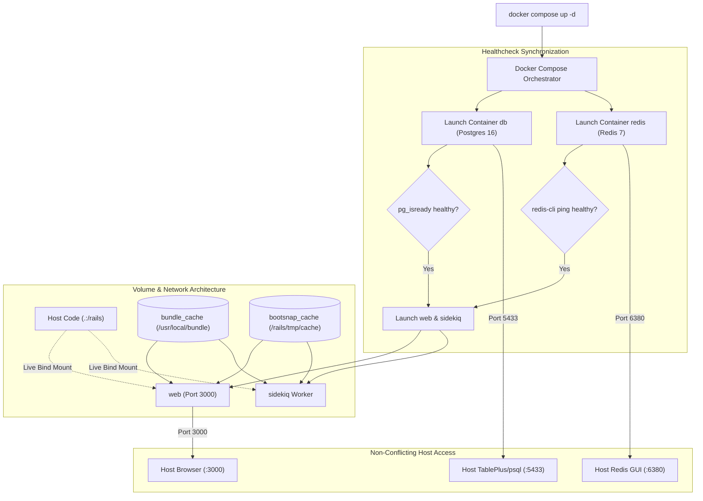

# Docker Development Environment Setup

## 1. Overview

This document details the **dedicated, containerized development environment** established in this application using **`Dockerfile.dev`**, **`bin/docker-entrypoint-dev`**, and **`docker-compose.yml`**.

- **Type**: Local Developer Tooling / Containerized Development Stack.
- **Components**: Rails Web (Puma), Sidekiq Worker, PostgreSQL 16 Alpine, Redis 7 Alpine.
- **Problems Solved**:
  - Delivers complete local environment parity without polluting the production `Dockerfile`.
  - Enables **instant code reloading** via host bind mounts (`.:/rails`).
  - Solves **Linux file permission disasters** by matching container user UID/GID to host developer UID `1000:1000`.
  - Solves the **stale `server.pid` boot loop** using intelligent entrypoint cleanup.
  - Prevents **host port collisions** (local host PostgreSQL `5432` and Redis `6379`) by mapping container ports to `5433` and `6380` on the host.
  - Persists gems across container rebuilds via a dedicated named volume (`bundle_cache`).
  - Isolates container Bootsnap cache from host cache via `bootsnap_cache`.
  - Enables **interactive terminal debugging** (`debug` / `binding.b` / `debugger`) via `docker compose attach web`.

---

## 2. Historical Timeline

| Commit | Date | Author / Context | Files Changed | Technical Change Introduced |
| :--- | :--- | :--- | :--- | :--- |
| [`fc5498e`](file:///home/devendra/work/App) | 2026-10-19 | Pre-Docker Config Updates | `config/environments/development.rb`, `config/settings/`, `config/sidekiq.yml` | Whitelisted `172.0.0.0/8` for `web-console`, disabled host authorization in development (`config.hosts.clear`), and added dynamic `DATABASE_NAME` support. |
| [`0e666e4`](file:///home/devendra/work/App) | 2026-10-19 | Docker Dev Environment Implementation | `Dockerfile.dev`, `bin/docker-entrypoint-dev`, `docker-compose.yml`, `.docker/postgres/init-test-db.sh` | Implemented complete development stack with non-root UID 1000 mapping, Bundler 2.6.9, stale PID cleanup, and healthcheck orchestration. |

---

## 3. Why This Setup Was Introduced

- **Verified Reason (Separate Development Dockerfile)**: Keeping [`Dockerfile.dev`](file:///home/devendra/work/App/Dockerfile.dev) dedicated preserves the production [`Dockerfile`](file:///home/devendra/work/App/Dockerfile) untouched. Development requires full compiler toolchains (`build-essential`, `libpq-dev`, `git`, `pkg-config`), debuggers, and test suites, whereas production images must remain strictly minimal and immutable.
- **Verified Reason (Host Port Collisions)**: Audit of the host system revealed that local PostgreSQL 12 and Redis instances were already actively listening on `127.0.0.1:5432` and `127.0.0.1:6379`. Binding standard `5432:5432` would fail with `listen tcp4 0.0.0.0:5432: bind: address already in use`. Publishing container ports to `${DB_PORT:-5433}:5432` and `${REDIS_PORT:-6380}:6379` completely avoids host conflicts while internal container networking remains on standard `5432` and `6379`.
- **Verified Reason (Stale `server.pid` Auto-Cleanup)**: When containers exit abruptly (laptop lid close, power off, `SIGKILL`), Rails leaves `tmp/pids/server.pid` behind. On the next `docker compose up`, Puma refuses to start: `A server is already running`. [`bin/docker-entrypoint-dev`](file:///home/devendra/work/App/bin/docker-entrypoint-dev) checks for and deletes leftover PID files whenever launching the web server.
- **Verified Reason (Git Safe Directory)**: Newer Git versions in containers throw `fatal: detected dubious ownership in repository at '/rails'` on bind-mounted directories. Setting `git config --global --add safe.directory '*'` resolves this permanently.

---

## 4. Files and Configuration Explained

### 1. Development Dockerfile: [`Dockerfile.dev`](file:///home/devendra/work/App/Dockerfile.dev)
```dockerfile
# syntax=docker/dockerfile:1
ARG RUBY_VERSION=3.3.6
FROM docker.io/library/ruby:$RUBY_VERSION-slim

# Match host Linux user permissions (UID 1000: GID 1000)
ARG UID=1000
ARG GID=1000

# Install build essentials and runtime libraries
RUN apt-get update -qq && \
    apt-get install --no-install-recommends -y \
      build-essential \
      git \
      libpq-dev \
      libvips \
      libyaml-dev \
      pkg-config \
      curl \
      postgresql-client \
      libjemalloc2 && \
    ln -s /usr/lib/$(uname -m)-linux-gnu/libjemalloc.so.2 /usr/local/lib/libjemalloc.so && \
    rm -rf /var/lib/apt/lists/* /var/cache/apt/archives/*

# Development environment
ENV RAILS_ENV="development" \
    BUNDLE_PATH="/usr/local/bundle" \
    BUNDLE_BIN="/usr/local/bundle/bin" \
    GEM_HOME="/usr/local/bundle" \
    HISTFILE="/rails/tmp/.bash_history" \
    TERM="xterm-256color" \
    LD_PRELOAD="/usr/local/lib/libjemalloc.so"
ENV PATH="/rails/bin:${BUNDLE_BIN}:${PATH}"

WORKDIR /rails

# Create non-root developer user
RUN groupadd --system --gid ${GID} rails && \
    useradd rails --uid ${UID} --gid ${GID} --create-home --shell /bin/bash && \
    mkdir -p /rails /usr/local/bundle /rails/tmp/cache /rails/tmp/pids /rails/tmp/sockets /rails/log && \
    chown -R rails:rails /rails /usr/local/bundle

USER rails:rails

# Configure git safe directory
RUN git config --global --add safe.directory '*'

# Pre-install bundler and gems for fast startup
COPY --chown=rails:rails Gemfile Gemfile.lock .ruby-version ./
RUN gem install bundler:2.6.9 && bundle install

# Copy development entrypoint script
COPY --chown=rails:rails bin/docker-entrypoint-dev /rails/bin/docker-entrypoint-dev

EXPOSE 3000
ENTRYPOINT ["/rails/bin/docker-entrypoint-dev"]
CMD ["./bin/rails", "server", "-b", "0.0.0.0", "-p", "3000"]
```

### 2. Development Entrypoint: [`bin/docker-entrypoint-dev`](file:///home/devendra/work/App/bin/docker-entrypoint-dev)
```bash
#!/bin/bash
set -e

# Clear stale server PID left by ungraceful container shutdown
if [[ "$*" == *"server"* || "$*" == *"rails s"* || "$*" == *"bin/dev"* ]]; then
  if [ -f /rails/tmp/pids/server.pid ]; then
    rm -f /rails/tmp/pids/server.pid
  fi
fi

exec "$@"
```

### 3. Orchestration: [`docker-compose.yml`](file:///home/devendra/work/App/docker-compose.yml)
```yaml
services:
  db:
    image: postgres:16-alpine
    restart: unless-stopped
    volumes:
      - postgres_data:/var/lib/postgresql/data
      - ./.docker/postgres/init-test-db.sh:/docker-entrypoint-initdb.d/init-test-db.sh:ro
    environment:
      POSTGRES_USER: postgres
      POSTGRES_PASSWORD: postgres
      POSTGRES_DB: app_development
    ports:
      - "${DB_PORT:-5433}:5432"
    healthcheck:
      test: ["CMD-SHELL", "pg_isready -U postgres -d app_development"]
      interval: 5s
      timeout: 5s
      retries: 5

  redis:
    image: redis:7-alpine
    restart: unless-stopped
    volumes:
      - redis_data:/data
    ports:
      - "${REDIS_PORT:-6380}:6379"
    healthcheck:
      test: ["CMD", "redis-cli", "ping"]
      interval: 5s
      timeout: 5s
      retries: 5

  web:
    build:
      context: .
      dockerfile: Dockerfile.dev
      args:
        UID: ${UID:-1000}
        GID: ${GID:-1000}
    command: ./bin/rails server -b 0.0.0.0 -p 3000
    volumes:
      - .:/rails
      - bundle_cache:/usr/local/bundle
      - bootsnap_cache:/rails/tmp/cache
    ports:
      - "${PORT:-3000}:3000"
    environment:
      RAILS_ENV: development
      GEM_HOME: /usr/local/bundle
      BUNDLE_PATH: /usr/local/bundle
      DATABASE_HOST: db
      DATABASE_PORT: 5432
      DATABASE_USERNAME: postgres
      DATABASE_PASSWORD: postgres
      REDIS_URL: redis://redis:6379/0
      RUBY_YJIT_ENABLE: "1"
      PORT: 3000
    depends_on:
      db:
        condition: service_healthy
      redis:
        condition: service_healthy
    stdin_open: true
    tty: true

  sidekiq:
    build:
      context: .
      dockerfile: Dockerfile.dev
      args:
        UID: ${UID:-1000}
        GID: ${GID:-1000}
    command: bundle exec sidekiq -C config/sidekiq.yml
    volumes:
      - .:/rails
      - bundle_cache:/usr/local/bundle
      - bootsnap_cache:/rails/tmp/cache
    environment:
      RAILS_ENV: development
      GEM_HOME: /usr/local/bundle
      BUNDLE_PATH: /usr/local/bundle
      DATABASE_HOST: db
      DATABASE_PORT: 5432
      DATABASE_USERNAME: postgres
      DATABASE_PASSWORD: postgres
      REDIS_URL: redis://redis:6379/0
      RUBY_YJIT_ENABLE: "1"
    depends_on:
      db:
        condition: service_healthy
      redis:
        condition: service_healthy

volumes:
  postgres_data:
  redis_data:
  bundle_cache:
  bootsnap_cache:
```

### 4. Automatic Test DB Initialization: [`.docker/postgres/init-test-db.sh`](file:///home/devendra/work/App/.docker/postgres/init-test-db.sh)
```bash
#!/bin/bash
set -e

psql -v ON_ERROR_STOP=1 --username "$POSTGRES_USER" --dbname "$POSTGRES_DB" <<-EOSQL
    SELECT 'CREATE DATABASE app_test'
    WHERE NOT EXISTS (SELECT FROM pg_database WHERE datname = 'app_test')\gexec
    GRANT ALL PRIVILEGES ON DATABASE app_test TO $POSTGRES_USER;
EOSQL
```

---

## 5. Dependencies and Prerequisites

- **Docker Engine**: 20.10+ / Docker Compose v2+.
- **Host User Mapping**: Defaults to UID/GID 1000 (configurable via `UID` and `GID` build args).

---

## 6. How the Setup Works



---

## 7. How to Reproduce the Setup

### Step 1: Create Development Entrypoint
Create `bin/docker-entrypoint-dev` (see section 4) and grant execute permissions:
```bash
chmod +x bin/docker-entrypoint-dev
```

### Step 2: Create Postgres Init Script
Create `.docker/postgres/init-test-db.sh` and make executable:
```bash
chmod +x .docker/postgres/init-test-db.sh
```

### Step 3: Create `Dockerfile.dev` and `docker-compose.yml`
Create `Dockerfile.dev` and `docker-compose.yml` with the contents from section 4.

### Step 4: Build and Start Stack
```bash
docker compose build
docker compose run --rm web bin/rails db:prepare
docker compose up -d
```

---

## 8. Verification and Operational Notes

| Verification Check | Target | Execution Command | Expected Output | Status |
| :--- | :--- | :--- | :--- | :--- |
| **Compose Build** | Docker | `docker compose build` | `Image app-web Built` / `Image app-sidekiq Built` | Executed & Verified |
| **DB Preparation & Seeds** | Docker | `docker compose run --rm web bin/rails db:prepare` | `Development Admin created: admin@example.com` | Executed & Verified |
| **All Services Up & Healthy** | Docker | `docker compose ps` | `db` (healthy), `redis` (healthy), `web` (up), `sidekiq` (up) | Executed & Verified |
| **HTTP Health Endpoint** | Docker | `curl -I http://localhost:3000/up` | `HTTP/1.1 200 OK` | Executed & Verified |
| **Admin Login Endpoint** | Docker | `curl -I http://localhost:3000/admin/login` | `HTTP/1.1 200 OK` | Executed & Verified |
| **Stale PID Recovery** | Docker | Inject fake PID and run `docker compose up -d web` | Stale PID deleted, Puma started successfully | Executed & Verified |
| **Full RSpec Suite in Docker** | Docker | `docker compose run --rm -e RAILS_ENV=test web bundle exec rspec` | 47 examples, 0 failures | Executed & Verified |

---

## 9. Current Status and Recommendations

- **Current Status**: Complete, fully functional, and verified.
- **Recommendations**:
  - Use `docker compose attach web` whenever attaching to interactive breakpoints (`binding.b` / `debugger`).
  - Use `docker compose run --rm web bundle add <gem_name>` when adding new gems to update `Gemfile.lock` and save gems into `bundle_cache` in a single command.

---

## 10. References

- **Git Commits**:
  - Configuration updates: [`fc5498e`](file:///home/devendra/work/App)
  - Full Docker dev stack implementation: [`0e666e4`](file:///home/devendra/work/App)
- **Files**:
  - [`Dockerfile.dev`](file:///home/devendra/work/App/Dockerfile.dev)
  - [`bin/docker-entrypoint-dev`](file:///home/devendra/work/App/bin/docker-entrypoint-dev)
  - [`docker-compose.yml`](file:///home/devendra/work/App/docker-compose.yml)
  - [`.docker/postgres/init-test-db.sh`](file:///home/devendra/work/App/.docker/postgres/init-test-db.sh)
- **Brain Artifact Reference**:
  - [`docker_development_setup_plan.md`](file:///home/devendra/.gemini/antigravity-cli/brain/542eecbf-173e-427b-b3b1-098927b3317d/docker_development_setup_plan.md)
